<div align="center">

# Ultron

**A voice-first AI assistant for Android that talks, chats, reads your files and operates your phone.**

Real-time voice conversations with Gemini Live · a streaming text chat with attachments · 80+ phone-control tools · cloud connectors over MCP · on-device memory and knowledge base

-3DDC84?logo=android&logoColor=white)


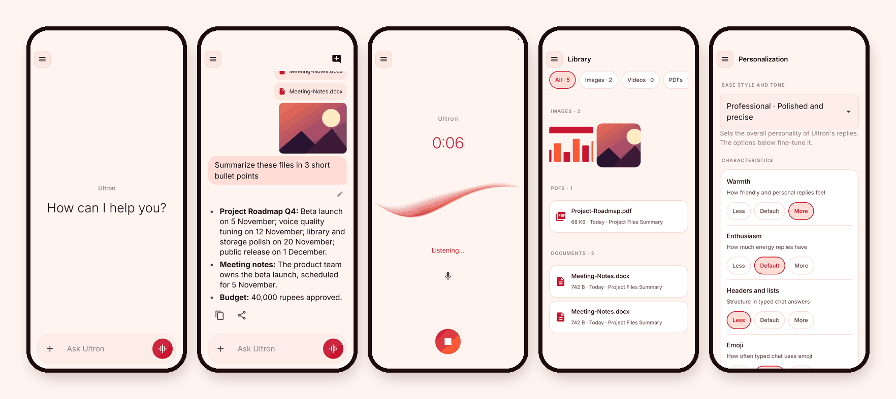

</div>

---

## Table of contents

1. [Overview](#overview)
2. [Screenshots](#screenshots)
3. [Features](#features)
4. [Architecture](#architecture)
5. [Tech stack](#tech-stack)
6. [Project structure](#project-structure)
7. [Getting started](#getting-started)
8. [Configuration reference](#configuration-reference)
9. [Cloud backend (AWS)](#cloud-backend-aws)
10. [Over-the-air updates](#over-the-air-updates)
11. [Testing](#testing)
12. [Privacy and security](#privacy-and-security)
13. [Known limitations](#known-limitations)
14. [Author](#author)

---

## Overview

Ultron is an Android app that works as an everyday assistant you can **talk to or type to**. Tap the mic and you are in a live,
interruptible voice conversation. Type instead and you get a fast, streaming chat that can read images, PDFs, Word documents and
videos you attach. Behind both sit the same building blocks: a long-term memory, a private knowledge base you fill with your own
documents, and a set of tools that let the assistant act, either on the phone itself or in the cloud services you connect.

The project has three parts:

| Part | Where | What it is |
|---|---|---|
| **Android app** | [`android/`](android) | The assistant itself, written in Kotlin with Jetpack Compose. |
| **Cloud connectors** | [`mcp/`](mcp) | Three small stateless AWS Lambda servers (YouTube, Google Workspace, update service). |
| **Release tooling** | [`scripts/`](scripts) | A PowerShell script that builds a small release and publishes it for over-the-air updates. |

---

## Screenshots

<table>
  <tr>
    <td align="center" width="25%">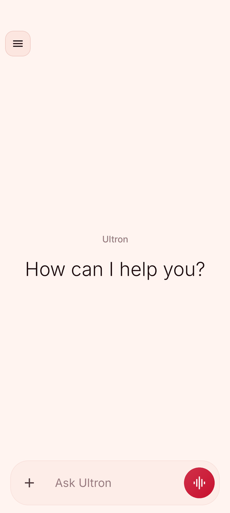<br><sub><b>Home</b><br>Ask by typing or tap the voice button</sub></td>
    <td align="center" width="25%">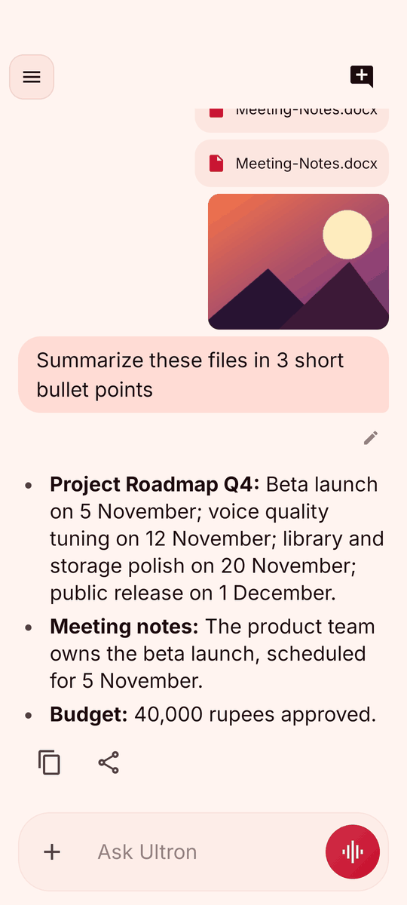<br><sub><b>Chat with files</b><br>Images, PDFs and Word files in one question</sub></td>
    <td align="center" width="25%">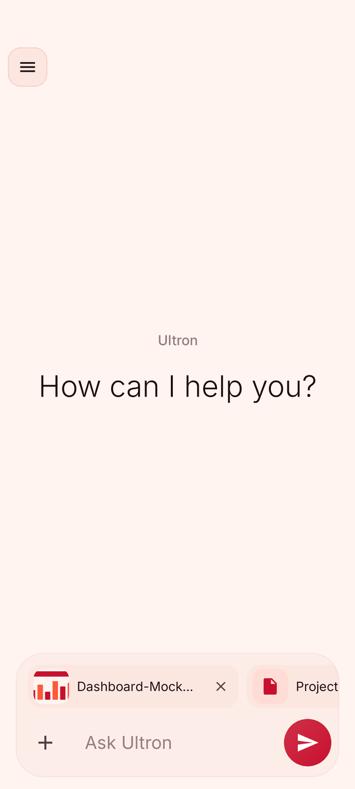<br><sub><b>Attach</b><br>Images, videos, PDFs, .docx and text</sub></td>
    <td align="center" width="25%">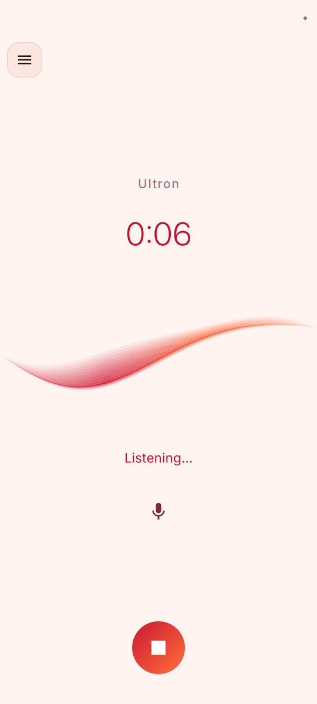<br><sub><b>Voice</b><br>Live, interruptible conversation</sub></td>
  </tr>
  <tr>
    <td align="center">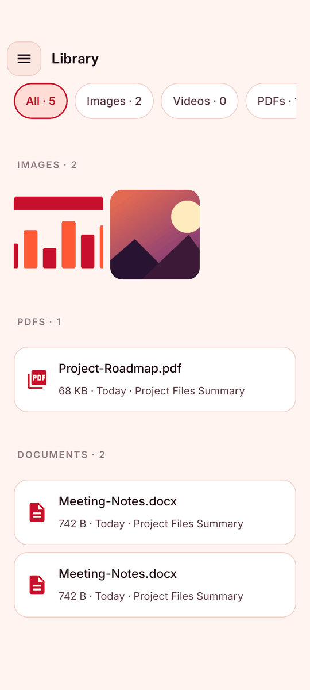<br><sub><b>Library</b><br>Every file you sent, sorted by type</sub></td>
    <td align="center">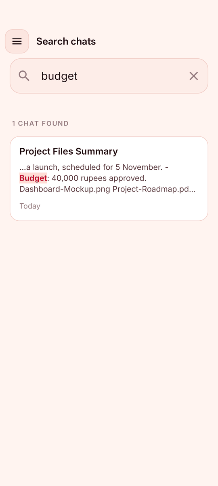<br><sub><b>Search chats</b><br>Find a conversation by any word in it</sub></td>
    <td align="center">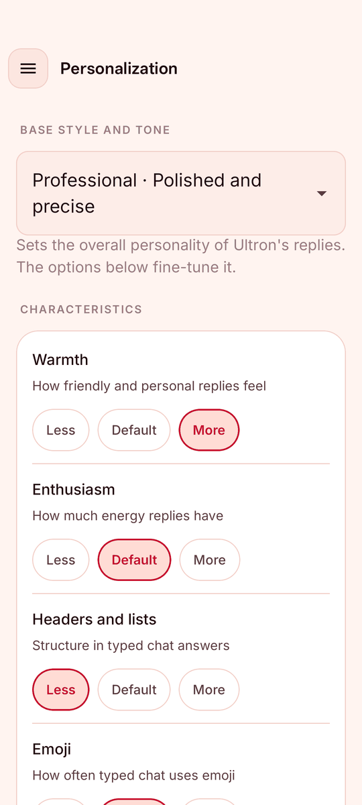<br><sub><b>Personalization</b><br>Style, tone and custom instructions</sub></td>
    <td align="center">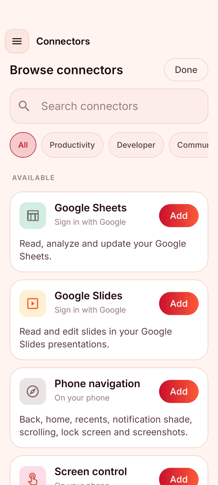<br><sub><b>Connectors</b><br>Add cloud and phone tools in one tap</sub></td>
  </tr>
  <tr>
    <td align="center">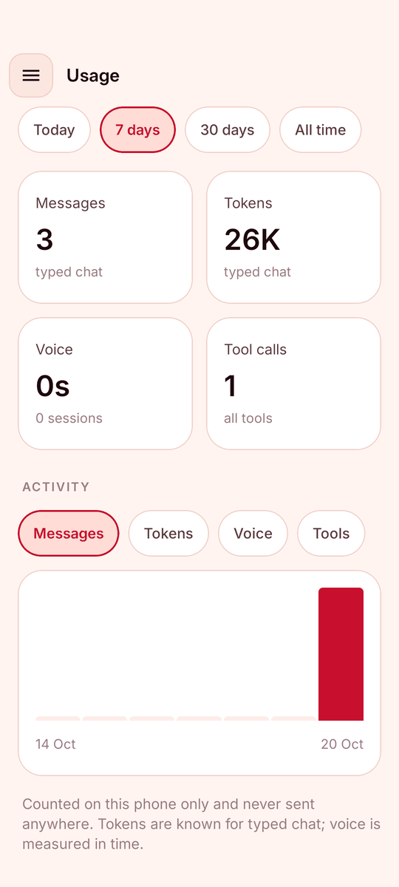<br><sub><b>Usage</b><br>Messages, tokens, voice time, tool calls</sub></td>
    <td align="center">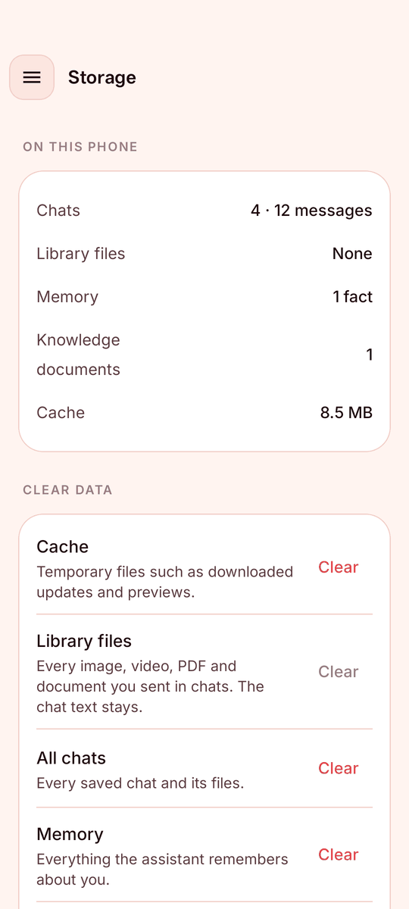<br><sub><b>Storage</b><br>See what is stored, clear what you want</sub></td>
    <td align="center">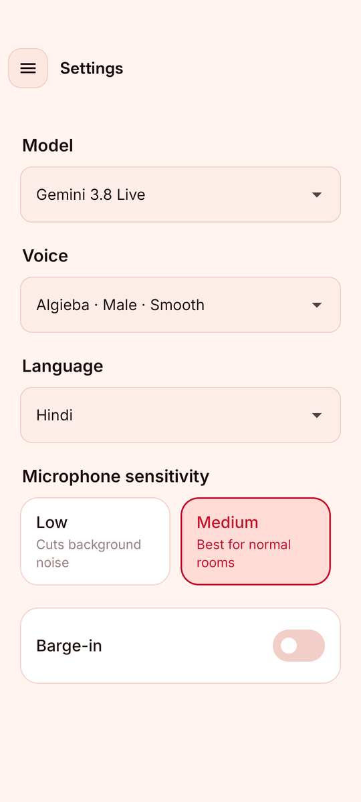<br><sub><b>Settings</b><br>Model, voice, language, microphone</sub></td>
    <td align="center">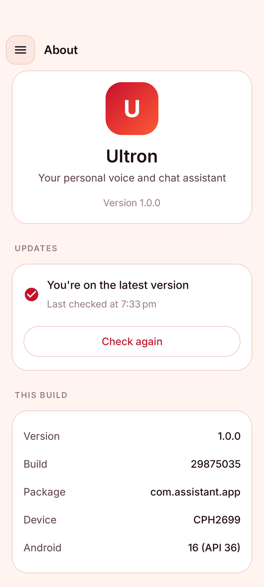<br><sub><b>About and updates</b><br>Build info and one-tap updates</sub></td>
  </tr>
</table>

<details>
<summary>Navigation menu</summary>

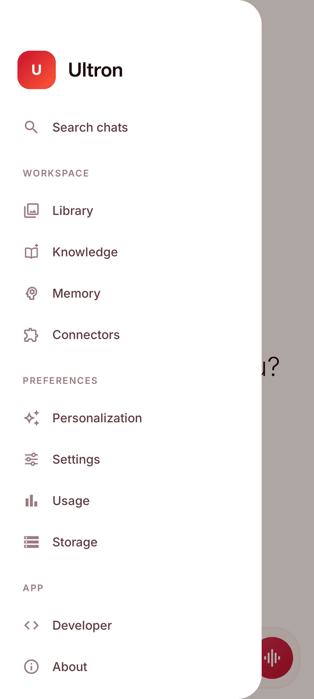

</details>

---

## Features

### Voice assistant

- **Real-time conversation** over the Gemini Live API: speak naturally, interrupt at any time (optional *barge-in*), and hear the reply as it is generated.
- **Three Live models** to choose from: *Gemini 3.8 Live*, *Gemini 3.8 Live (extended thinking)* and *Gemini 3.1 Flash Live (preview)*.
- **30 prebuilt voices** (for example Algieba, Kore, Puck, Sulafat). The assistant knows the gender of the chosen voice and uses matching grammar in gendered languages such as Hindi.
- **13 spoken languages**: English (India), Hindi, Bengali, Tamil, Telugu, Marathi, Gujarati, Kannada, Malayalam, Punjabi, Urdu, Odia and Assamese.
- **Fast start**: a session is pre-warmed in the background, so tapping the mic feels instant.
- **Microphone sensitivity** (low, medium, high) for noisy rooms or quiet voices.
- **Foreground service** keeps a session alive with the screen off, with Stop and Mute actions in the notification. A session is capped at 15 minutes and ends after 2 minutes of silence, and the short context used to resume a conversation is cleared when a session ends.
- **Live waveform ribbon** and a session timer on the voice screen.

### Text chat

- **Streaming replies** with a Markdown renderer (headings, lists, tables, code, links), a typing indicator and a live tool status ("Searching the web…").
- **Attachments**: images, **videos**, PDFs, **Word (.docx)** and plain-text files. Word text is extracted on the device; images, PDFs and videos are sent to the model directly.
- **Edit and resend** any of your messages (the chat after it is replaced), **copy** and **share** any reply.
- **Auto-titles**: the model names each chat after what it was about, and refreshes the title as the topic develops.
- **Two chat engines**: Gemini (default) or **Azure OpenAI**, switchable in Developer settings.
- **Tools in chat**: web search, connected cloud services, knowledge-base search and memory. Phone-control tools stay voice-only on purpose.

### Phone control (voice)

More than **80 device tools** let the assistant act on the phone. Each group can be switched on or off, and the sensitive ones are off by default.

| Group | Examples |
|---|---|
| Display and sound | brightness, volume, ringer mode, vibrate, flashlight, do not disturb |
| Phone info | time, battery, network, storage and memory, device info, Wi-Fi, Bluetooth, clipboard |
| Apps | open an app, open app settings, play music, open the camera |
| Alarms and timers | set an alarm, set a timer, schedule a reminder |
| Calls and messages | dial, search contacts, call a contact, create a contact |
| Contacts and calendar | upcoming events, birthdays, conflict check, create an event |
| Location and maps | current location, directions |
| Notes | create, search and delete notes |
| Web | weather, open a website, share text, read a web page, news headlines, currency rates, website status, internet speed test |
| Navigation and screen control | back, home, recents, notification shade, quick settings, scroll, lock screen, screenshot, media keys |
| Screen reading and tapping | read and tap what is on screen (accessibility service, **off by default**) |
| Automation | schedule a tool to run later or repeatedly, or add a rule that fires on a phone event; results are posted as a notification |
| Photos, sensors and health | recent photos, step counter, light sensor |
| Private data | read notifications, most-used apps and app usage time (**off by default**) |

### Connectors (MCP)

Connectors are added from a built-in browse view, each with per-tool switches and its own sign-in. The chat uses the **cloud** connectors; voice uses all of them.

| Connector | What it does | How it connects |
|---|---|---|
| **Phone apps** | Calendar, contacts, notifications, navigation, screen control | Local, uses Android permissions you grant |
| **Web search** | Search the web and cite sources | Built-in client |
| **GitHub** | Browse repositories, issues and pull requests | Sign in with GitHub (OAuth device flow) |
| **YouTube** | Search videos, get video details, read transcripts, list a channel's videos | Private MCP server on AWS Lambda (yt-dlp) |
| **Google Calendar, Gmail, Drive, Docs, Sheets, Slides** | Read and edit your Google data, Gmail drafts are never sent automatically | Per-service Google sign-in plus a stateless Google Workspace MCP server on AWS Lambda |

A connector whose sign-in expires shows *Reconnect* and *Remove* instead of failing silently.

### Knowledge base (RAG)

Add your own documents (typed text or PDF) and ask about them in chat or by voice.

- PDFs are converted by a model into paragraph-sized, titled chunks, then embedded with **`gemini-embedding-2`** (768-dimension vectors).
- Search is **hybrid**: vector similarity and BM25 keyword rankings are merged with *reciprocal rank fusion*, and neighbouring chunks are added for context.
- Chunks and vectors are stored on the device in **ObjectBox**, with a consistency checker and a migration path when the embedding model changes.
- One tap can draft the assistant's persona from your documents.

### Memory

The assistant saves lasting facts you tell it (up to 150 short notes) and recalls them in later chats and calls. You can add, edit, delete or switch memory off, and a changed fact replaces the old one instead of sitting next to its opposite. Saved notes are treated as facts about you, never as instructions.

### Personalization

Fine-tune how the assistant talks, similar to the controls in popular chat apps:

- **Base style and tone**: Default, Professional, Friendly, Candid, Quirky, Efficient, Nerdy, Cynical.
- **Characteristics**: Warmth, Enthusiasm, Headers and lists, Emoji, each Less / Default / More. Headers, lists and emoji apply to typed chat only.
- **Custom instructions** and an **About you** card (nickname, occupation, anything else).

Choices apply to both typed chat and voice.

### Library, search, usage and storage

- **Library**: every image, video, PDF and document you sent, grouped by type, with thumbnails, a built-in viewer (zoomable images, PDF pages, text, video player) and per-file delete.
- **Search chats**: find any conversation by words in its title, messages or file names, with the matches highlighted.
- **Usage**: messages, tokens (typed chat), voice time and tool calls per day, with 7 day, 30 day and all-time charts. Everything stays on the phone.
- **Storage**: what is stored (chats, library files, memory, knowledge, cache) and one-tap clear for each, including *Clear chats and memory*.

---

## Architecture

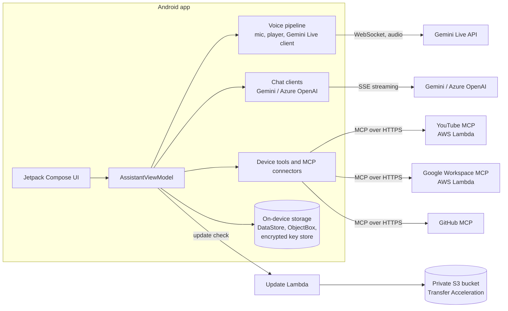

**How a typed message flows:** the view model builds the system prompt (persona, personalization, memories), sends the recent
messages and attachments to the chat client, and streams the reply back. When the model calls a tool, the client runs it, feeds
the result back, and keeps going for up to five rounds before answering. Token usage reported by the provider is recorded locally.

**How a voice session flows:** the view model builds the Live system instruction, opens (or promotes a pre-warmed) Live
connection, streams microphone audio and plays the model's audio, and runs tool calls the model asks for, including device tools,
memory, knowledge search and connectors.

---

## Tech stack

| Area | Technology |
|---|---|
| Language and UI | Kotlin 2.0.20, Jetpack Compose, Material 3 |
| Voice | Gemini Live API (WebSocket), `AudioRecord`/`AudioTrack` pipeline with echo cancellation |
| Chat | Gemini streaming (SSE) with function calling; Azure OpenAI as an alternative |
| Retrieval | `gemini-embedding-2` vectors, BM25, reciprocal rank fusion, ObjectBox |
| Storage | Jetpack DataStore, ObjectBox, `EncryptedSharedPreferences` (AES-256) |
| Networking | OkHttp 4, Kotlin coroutines and Flow |
| Auth | Google Sign-In (Play services), GitHub OAuth device flow |
| Connectors | Model Context Protocol over HTTPS (streamable HTTP, JSON responses) |
| Backend | AWS Lambda (Python 3.12, arm64, Function URLs), S3 with Transfer Acceleration |
| Build | Gradle (AGP 8.5.2), Docker build image, R8 shrinking for release and OTA builds |

Minimum Android version is 8.0 (API 26); the app targets and compiles against API 35.

---

## Project structure

```text
.
├── android/                         Android application (Gradle project)
│   ├── app/src/main/java/com/assistant/app/
│   │   ├── audio/                   Microphone streaming, playback, amplitude
│   │   ├── data/                    Settings, stores, device tools, RAG, personalization, usage
│   │   ├── network/                 Gemini Live and chat clients, MCP client, updater
│   │   ├── ui/                      Compose screens, pages and theme
│   │   ├── util/                    Latency tracing, user-facing errors
│   │   └── viewmodel/               AssistantViewModel and UI state
│   ├── app/src/test/                Unit tests (19 test files)
│   ├── Dockerfile                   Reproducible build environment
│   └── local.properties.example     Template for local configuration
├── mcp/                             AWS Lambda servers
│   ├── youtube-search/              YouTube MCP server (yt-dlp)
│   ├── google-workspace/            Google Workspace MCP server (REST APIs)
│   └── ultron-updates/              Update check and download-link service
├── scripts/publish-update.ps1       Build and publish an over-the-air update
├── docs/screenshots/                Images used in this README
└── track.md                         Change log of every change made to the project
```

---

## Getting started

### Prerequisites

- A Google AI Studio **Gemini API key** (voice, chat and knowledge base all use it).
- Either **Docker** (recommended, no local Android SDK needed) or **JDK 17 + Android SDK 35** with a local Gradle toolchain.
- An Android phone with USB or wireless debugging for installing the debug build.

### 1. Clone and configure

```bash
git clone https://github.com/devxjitin/ultron-android.git
cd ultron-android/android
cp local.properties.example local.properties
```

Open `android/local.properties` and set at least `sdk.dir` (skip it when building with Docker) and `GEMINI_API_KEY`. Every other
key is optional; see the [configuration reference](#configuration-reference). The file is git-ignored and must never be committed.

### 2. Build

**With Docker**

```bash
docker build -t assistant-android-build .
docker run --rm \
  -v "$PWD:/workspace" \
  -v assistant-gradle-cache:/root/.gradle \
  -v assistant-android-home:/root/.android \
  -w /workspace assistant-android-build ./gradlew assembleDebug
```

The APK is written to `android/.docker-build/app/outputs/apk/debug/app-debug.apk`. The two named volumes keep the Gradle cache and
a stable debug key, so repeat builds are fast and `adb install -r` keeps working.

**With a local toolchain**

```bash
./gradlew assembleDebug
```

### 3. Install and run

```bash
adb install -r app-debug.apk
```

Open the app, allow the microphone, and start talking or typing. You can also enter or change the Gemini key at any time under
**Developer** in the menu, and that value wins over the build-time one.

### Build variants

| Variant | Command | Notes |
|---|---|---|
| `debug` | `./gradlew assembleDebug` | Full APK, debuggable. |
| `ota` | `./gradlew assembleOta` | Shrunk with R8, arm64 and armeabi-v7a only, signed with the debug key so it installs over a debug build. This is what the update server delivers (about 8 MB). |
| `release` | `./gradlew assembleRelease` | Shrunk, signed with your own keystore (set the `RELEASE_*` keys). |

---

## Configuration reference

All build-time values live in `android/local.properties` and are exposed to the app through `BuildConfig`.

| Key | Required | Purpose |
|---|---|---|
| `sdk.dir` | for local builds | Path to the Android SDK. |
| `GEMINI_API_KEY` | recommended | Default Gemini key. Can also be entered in the app under Developer. |
| `GITHUB_CLIENT_ID` | optional | Public client id of a GitHub OAuth App (device flow) for *Sign in with GitHub*. |
| `YOUTUBE_MCP_URL` | optional | URL of your YouTube MCP server, so the YouTube connector adds in one tap. |
| `GOOGLE_MCP_URL` | optional | Base URL of your Google Workspace MCP server, used by the six Google connectors. |
| `AZURE_ENDPOINT` | optional | Azure OpenAI resource used by the *Azure API key* chat option. The key itself is entered in the app. |
| `UPDATE_URL` | optional | Update server URL, enables in-app updates. |
| `RELEASE_STORE_FILE`, `RELEASE_STORE_PASSWORD`, `RELEASE_KEY_ALIAS`, `RELEASE_KEY_PASSWORD` | release builds | Release signing configuration. |

Values that contain a secret token end up inside the APK, so do not share builds made with private URLs.

---

## Cloud backend (AWS)

The connector servers are intentionally small: no database, no third-party dependency except `yt-dlp`, and nothing is stored.
Each one runs as a Lambda function behind a **Function URL**, with a secret first path segment (`ACCESS_TOKEN`) that rejects
every other request.

| Server | Folder | Tools | Notes |
|---|---|---|---|
| **YouTube** | [`mcp/youtube-search`](mcp/youtube-search) | `search_videos`, `get_video_info`, `get_transcript`, `list_videos` | Uses `yt-dlp` bundled in the deployment package. |
| **Google Workspace** | [`mcp/google-workspace`](mcp/google-workspace) | Calendar, Gmail, Drive, Docs, Sheets, Slides | Pure standard library. The phone sends its own Google OAuth token as a Bearer header; the server only forwards it to Google and keeps nothing. Gmail can only create drafts, never send. |
| **Updates** | [`mcp/ultron-updates`](mcp/ultron-updates) | `GET /<token>/latest` | Returns the newest build's metadata and a short-lived download link. |

Suggested runtime settings: Python 3.12, **arm64**, 128 to 512 MB depending on the server. Deploy by zipping the folder's
`lambda_function.py` (and dependencies for YouTube), creating a Function URL with auth type `NONE`, and setting the
`ACCESS_TOKEN` environment variable. The update server also needs a `BUCKET` variable.

All three speak MCP over streamable HTTP with JSON responses, so any MCP client can use them.

---

## Over-the-air updates

The app can update itself from your own AWS account, with no app store involved.

1. [`scripts/publish-update.ps1`](scripts/publish-update.ps1) builds the `ota` variant in Docker, uploads the APK to a **private S3 bucket**, and writes `latest.json` last, so a build only becomes visible once it is fully uploaded. Only the newest three builds are kept.
2. The update Lambda reads `latest.json` and returns it with a **presigned download link that expires after 30 minutes**. Links use **S3 Transfer Acceleration**, so phones far from the bucket's region download through the nearest AWS edge.
3. The app checks on launch and again **every 5 minutes while it stays open**, so a running app (a kiosk, for example) is updated too. If a build is found on an unmetered network, it is **downloaded quietly in the background**, so tapping *Update* installs immediately.
4. The download is verified against its **SHA-256** before the installer opens, and Android itself refuses any package that is not signed with the same key as the installed app.
5. **About → Check for updates** shows the result inline: checking, up to date, update available with size and notes, or an error.

To publish a build: `aws login`, make sure Docker is running, then

```powershell
.\scripts\publish-update.ps1 -Notes "What changed"
```

---

## Testing

Unit tests cover the pure logic: retrieval and chunking, embedding retry policy, tool-response formatting, settings persistence,
latency tracing, error messages and more.

```bash
cd android
./gradlew testDebugUnitTest                              # all unit tests
./gradlew testDebugUnitTest --tests "*KnowledgeBaseProviderTest*"   # one class
```

UI changes are checked by installing a build on a phone and walking through the screens.

---

## Privacy and security

- **Your data stays on the phone.** Chats, attachments, memory, knowledge documents and usage counters are stored locally. Usage counters are never sent anywhere.
- **API keys are encrypted at rest** (AES-256 through Android's keystore-backed `EncryptedSharedPreferences`). Private keys, tokens and signing files are git-ignored.
- **What leaves the phone:** your messages, voice and attachments go to the AI provider you configured (Gemini or Azure OpenAI) to produce replies, and tool calls go to the connectors you added.
- **Connector servers hold nothing.** They are stateless; Google tokens travel per request and are never stored.
- **Sensitive abilities are opt-in.** Screen reading and tapping, and notification access, are off until you turn them on and grant the Android permission yourself.
- **Prompt-injection aware.** Text you paste, attached files, web pages and tool output are treated as data, never as instructions. Gmail drafts are never sent automatically.
- **Updates are verified** by checksum and by Android's signature check.

---

## Known limitations

- Attachments are limited to **10 MB per file and 12 MB per message**, with up to five files at a time.
- When the **Azure OpenAI** chat engine is active, videos are not analysed (the model is told a video was attached); Gemini handles them.
- **Word** support covers `.docx`; the older binary `.doc` format is not read.
- Token counts are recorded for typed chat only; voice usage is measured in time.
- Screen reading and some phone-control tools depend on permissions Android may restrict for sideloaded apps.

---

## Author

Built by **Jitin Kumar Sengar** · devxjitin@gmail.com

Every change to the project is logged in [`track.md`](track.md).
