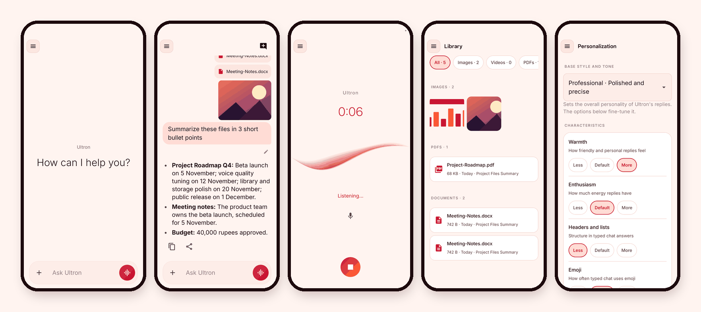
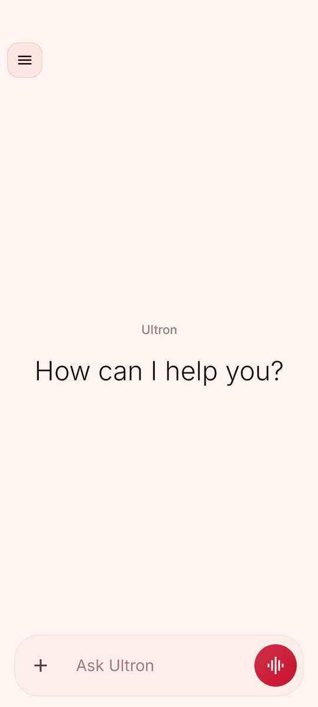
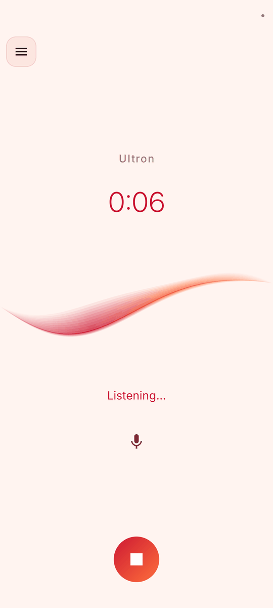
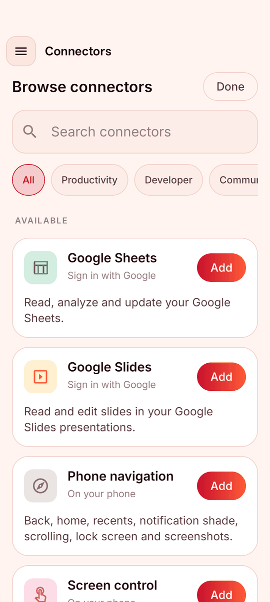
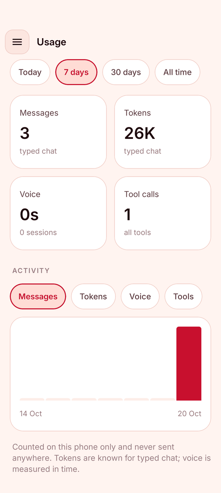
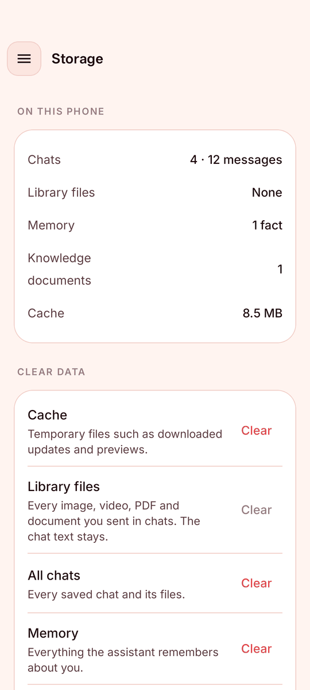
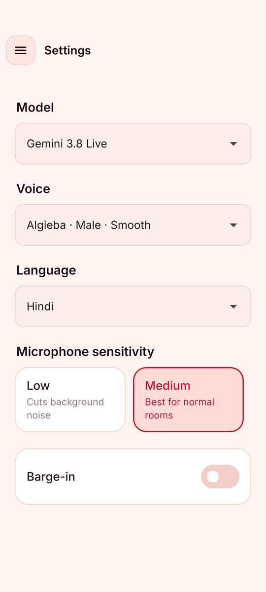
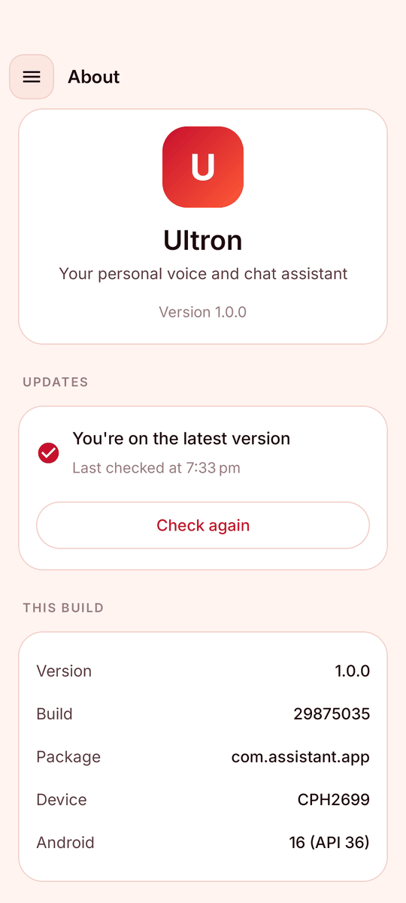
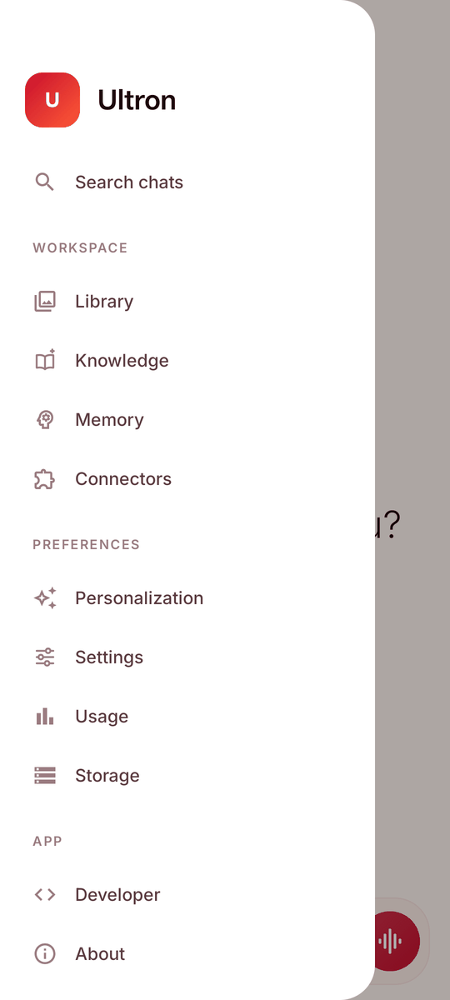
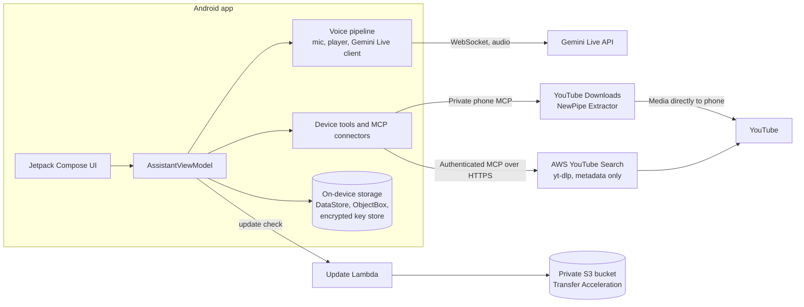

<div align="center">

# Ultron

**A voice assistant for Android that talks with you and operates your phone.**

Real-time voice conversations with Gemini Live · 80+ phone-control tools · cloud connectors over MCP · on-device memory and knowledge base

-3DDC84?logo=android&logoColor=white)




</div>

---

## Table of contents

1. [Overview](#overview)
2. [Screenshots](#screenshots)
3. [Features](#features)
4. [Architecture](#architecture)
5. [Tech stack](#tech-stack)
6. [Project structure](#project-structure)
7. [Getting started](#getting-started)
8. [Configuration reference](#configuration-reference)
9. [Cloud backend (AWS)](#cloud-backend-aws)
10. [Over-the-air updates](#over-the-air-updates)
11. [Testing](#testing)
12. [Privacy and security](#privacy-and-security)
13. [Known limitations](#known-limitations)
14. [Author](#author)

---

## Overview

Ultron is an Android voice assistant. Tap the mic and you are in a live, interruptible voice conversation. Behind it sit a
long-term memory, a private knowledge base you fill with your own documents, and a set of tools that let the assistant act,
either on the phone itself or in the cloud services you connect.

The project has three parts:

| Part | Where | What it is |
|---|---|---|
| **Android app** | [`android/`](android) | The assistant itself, written in Kotlin with Jetpack Compose. |
| **Cloud connectors** | [`mcp/`](mcp) | Small stateless AWS Lambda servers (web extract, update service). |
| **Release tooling** | [`scripts/`](scripts) | A PowerShell script that builds a small release and publishes it for over-the-air updates, plus a latency-log summary script. |

---

## Screenshots

<table>
  <tr>
    <td align="center" width="25%"><br><sub><b>Home</b><br>Tap the mic to talk</sub></td>
    <td align="center" width="25%"><br><sub><b>Voice</b><br>Live, interruptible conversation</sub></td>
  </tr>
  <tr>
    <td align="center"><br><sub><b>Connectors</b><br>Add cloud and phone tools in one tap</sub></td>
  </tr>
  <tr>
    <td align="center"><br><sub><b>Usage</b><br>Messages, tokens, voice time, tool calls</sub></td>
    <td align="center"><br><sub><b>Storage</b><br>See what is stored, clear what you want</sub></td>
    <td align="center"><br><sub><b>Settings</b><br>Model, voice, language, microphone</sub></td>
    <td align="center"><br><sub><b>About and updates</b><br>Build info and one-tap updates</sub></td>
  </tr>
</table>

<details>
<summary>Navigation menu</summary>



</details>

---

## Features

### Voice assistant

- **Real-time conversation** over the Gemini Live API: speak naturally, interrupt at any time (*barge-in*, on by default and switchable in Settings), and hear the reply as it is generated.
- **Two Live models** to choose from: *Gemini 3.8 Live* and *Gemini 3.1 Flash Live (preview)*.
- **30 prebuilt voices** (for example Algieba, Kore, Puck, Sulafat). The assistant knows the gender of the chosen voice and uses matching grammar in gendered languages such as Hindi.
- **13 spoken languages**: English (India), Hindi, Bengali, Tamil, Telugu, Marathi, Gujarati, Kannada, Malayalam, Punjabi, Urdu, Odia and Assamese.
- **Fast start**: a session is pre-warmed in the background, so tapping the mic feels instant.
- **Microphone sensitivity** (low, medium, high) for noisy rooms or quiet voices.
- **Foreground service** keeps a session alive with the screen off, with Stop and Mute actions in the notification. A session is capped at 15 minutes and ends after 2 minutes of silence, and the short context used to resume a conversation is cleared when a session ends.
- **Live waveform ribbon** and a session timer on the voice screen.

### Light and dark theme

The home screen has a day/night button at the top right that switches between the light and dark theme (the first launch follows the phone). The choice is saved and applied before the first frame. Both palettes are contrast-checked so text stays readable on every surface.

### Connectors

Every connector is defined in code with its fixed set of tools and a **surface**: *Voice*, or *Voice only* (automation). A fresh install starts with a safe set switched on (device info, device controls, alarms, apps and settings, web search, web reader, weather, phone navigation and screen control); the rest, such as calls, messages and notifications, stay off until you connect them. The sidebar has one place, **Connectors**, which lists every connector, connected or not, in A-Z order, with two buttons at the top:

- **Installed** shows the Voice connectors. Connect turns a connector's tools on (and asks for the Android permission or access it needs, or the sign-in); a connected one shows Connected.
- **Automation** shows the phone-control connectors, which are voice only.

| Connector | Tools | Surface |
|---|---|---|
| Device info | time, battery, device info, storage and memory, network, Wi-Fi, Bluetooth, step count, light level | Voice |
| Device controls | flashlight, brightness, volume, ringer mode, vibrate, do not disturb, media keys, screen timeout, auto-rotate | Voice |
| Alarms and reminders | set an alarm, set a timer, schedule, list and cancel reminders | Voice |
| Calendar | upcoming events, conflict check, create an event | Voice |
| Contacts | search a contact, birthdays, open a form to save a contact | Voice |
| Location | current location, directions | Voice |
| Notifications | read current notifications | Voice |
| App usage | most-used apps, app usage time | Voice |
| DuckDuckGo | web search with sources | Voice |
| YouTube Search | search videos, video details, available transcripts, and channel or playlist videos through the read-only AWS MCP service using yt-dlp; no API key. YouTube may block cloud lookups | Voice |
| YouTube Downloads | a separate private MCP on the phone: list formats/qualities and save video or audio to Downloads/Ultron using NewPipe Extractor. Media never passes through AWS | Voice |
| Apps and settings | open an app, the camera and settings, clipboard, show a notification | Voice only |
| Phone navigation | back, home, recents, notification shade, quick settings, scroll, lock screen, screenshot (accessibility service) | Voice only |
| Screen control | read and tap what is on screen, type, wait for text (accessibility service) | Voice only |

Tap any connector card to open its own page: what it does, where it runs, what it needs, where your data goes and every tool it has.

A connector whose sign-in expires shows *Reconnect* and *Remove* instead of failing silently.

### Knowledge base (RAG)

Add your own documents (typed text or PDF) and ask about them by voice.

- PDFs are converted by a model into paragraph-sized, titled chunks, then embedded with **`gemini-embedding-2`** (768-dimension vectors).
- Search is **hybrid**: vector similarity and BM25 keyword rankings are merged with *reciprocal rank fusion*, and neighbouring chunks are added for context.
- Chunks and vectors are stored on the device in **ObjectBox**, with a consistency checker and a migration path when the embedding model changes.
- One tap can draft the assistant's persona from your documents.

### Memory

The assistant saves lasting facts you tell it (up to 150 short notes) and recalls them in later conversations. You can add, edit, delete or switch memory off, and a changed fact replaces the old one instead of sitting next to its opposite. When a replacement matches several notes equally well, nothing is deleted and the assistant is asked to pick the exact one. Saved notes are treated as facts about you, never as instructions.

### Usage and storage

- **Usage**: tokens, voice time and tool calls per day, with 7 day, 30 day and all-time charts. Everything stays on the phone.
- **Storage**: what is stored (memory, knowledge, cache) and one-tap clear for each.

---

## Architecture



**How a voice session flows:** the view model builds the Live system instruction, opens (or promotes a pre-warmed) Live
connection, streams microphone audio and plays the model's audio, and runs tool calls the model asks for, including device tools,
memory, knowledge search and connectors.

---

## Tech stack

| Area | Technology |
|---|---|
| Language and UI | Kotlin 2.0.20, Jetpack Compose, Material 3 |
| Voice | Gemini Live API (WebSocket), `AudioRecord`/`AudioTrack` pipeline with echo cancellation |
| Retrieval | `gemini-embedding-2` vectors, BM25, reciprocal rank fusion, ObjectBox |
| Storage | Jetpack DataStore, ObjectBox, `EncryptedSharedPreferences` (AES-256) |
| Networking | OkHttp 4, Kotlin coroutines and Flow |
| Connectors | Model Context Protocol over HTTPS (streamable HTTP, JSON responses) |
| Backend | AWS Lambda (Python 3.14), API Gateway, S3 with Transfer Acceleration |
| Build | Gradle (AGP 8.5.2), Android CLI for SDK, install and run, R8 shrinking for release and OTA builds |

Minimum Android version is 8.0 (API 26); the app targets API 35 and compiles against API 36.

---

## Project structure

```text
.
├── android/                         Android application (Gradle project)
│   ├── app/src/main/java/com/assistant/app/
│   │   ├── audio/                   Microphone streaming, playback, amplitude
│   │   ├── data/                    Settings, stores, device tools, RAG, usage
│   │   ├── network/                 Gemini Live client, MCP client, updater
│   │   ├── ui/                      Compose screens, pages and theme
│   │   ├── util/                    Latency tracing, user-facing errors
│   │   └── viewmodel/               AssistantViewModel and UI state
│   ├── app/src/test/                Unit tests (about 44 test files)
│   └── local.properties.example     Template for local configuration
├── mcp/                             AWS Lambda servers
│   ├── ultron-updates/              Update check and download-link service
│   └── web-extract/                 Web page content and metadata extraction server (deployed on AWS Lambda; not used by the app yet)
├── infra/ultron.yaml                CloudFormation template for the AWS backend
├── scripts/
│   ├── publish-update.ps1           Build and publish an over-the-air update
│   └── summarize_latency.py         Summarize captured logcat latency traces
├── docs/
│   ├── Idea.md                      Review notes, white-label plan, UI blueprint, future scope
│   └── screenshots/                 Images used in this README
└── track.md                         Change log of every change made to the project
```

---

## Getting started

### Prerequisites

- **Python 3.14** for backend tests and Lambda packaging. On this PC the project environment is `X:\tmp\kira-py314`.
- A Google AI Studio **Gemini API key** (voice and knowledge base both use it).
- **JDK 17 or newer** and the **Android SDK** (platform 36, build-tools 36.0.0), set up with the Android CLI (`android`). Set `ANDROID_HOME` to the SDK folder.
- An Android phone with USB or wireless debugging, or an emulator, for installing the debug build.

```bash
android sdk install platforms/android-36 build-tools/36.0.0 platform-tools
android info          # prints the SDK location and connected devices
```

### 1. Clone and configure

```bash
git clone https://github.com/devxjitin/ultron-android.git
cd ultron-android/android
cp local.properties.example local.properties
```

Open `android/local.properties` and set `sdk.dir` if `ANDROID_HOME` is not set. Every other
key is optional; see the [configuration reference](#configuration-reference). The file is git-ignored and must never be committed.

### 2. Build

```bash
./gradlew assembleDebug
```

The APK is written to `android/app/build/outputs/apk/debug/app-debug.apk`. `android describe` prints the output paths of every build target.

### 3. Install and run

With a phone or emulator connected (`android emulator list` / `android emulator start <name>` for a virtual one):

```bash
android run --apks=app/build/outputs/apk/debug/app-debug.apk
```

`android run` installs the APK and launches the app. Use `android install --apks=...` to install without launching, or
`adb install -r app-debug.apk` if you prefer plain adb. `android screen capture -o screen.png` takes a screenshot of the device.

Open the app, allow the microphone, and start talking or typing. You can also enter or change the Gemini key at any time under
**Developer** in the menu, and that value wins over the build-time one.

### Build variants

| Variant | Command | Notes |
|---|---|---|
| `debug` | `./gradlew assembleDebug` | Full APK, debuggable. |
| `ota` | `./gradlew assembleOta` | Shrunk with R8, arm64 and armeabi-v7a only, signed with the debug key so it installs over a debug build. This is what the update server delivers (about 8 MB). |
| `release` | `./gradlew assembleRelease` | Shrunk, signed with your own keystore (set the `RELEASE_*` keys). |

---

## Configuration reference

All build-time values live in `android/local.properties` and are exposed to the app through `BuildConfig`.

| Key | Required | Purpose |
|---|---|---|
| `sdk.dir` | if `ANDROID_HOME` is unset | Path to the Android SDK. |

**Gemini key.** Ultron always uses your own Gemini key (BYOK), entered in the app under **Developer** in the menu; the app licence key does not include Gemini usage. Firebase is used for sign-in, App Check, Crashlytics and Analytics only, not for Gemini. The Knowledge (embeddings) key is optional and falls back to the Gemini key.
| `RELEASE_STORE_FILE`, `RELEASE_STORE_PASSWORD`, `RELEASE_KEY_ALIAS`, `RELEASE_KEY_PASSWORD` | release builds | Release signing configuration. |

Values that contain a secret token end up inside the APK, so do not share builds made with private URLs.

---

## Cloud backend (AWS)

The project targets **Python 3.14** locally, in CI, in Lambda templates and in Linux dependency packages. `.python-version` records the version. Rebuild the web-extract and YouTube ZIPs before deploying a runtime change; changing the PC interpreter or repository templates alone does not change deployed Lambda runtimes. AWS supports the managed `python3.14` runtime ([runtime documentation](https://docs.aws.amazon.com/lambda/latest/dg/lambda-runtimes.html)).

The connector servers are intentionally small Lambda functions. The current API ([`infra/api.yaml`](infra/api.yaml)) sits behind
API Gateway with a Firebase sign-in (JWT) check. The licence servers keep only hashed activation keys and the buyer details in
DynamoDB; the connector servers store no content. The older Function URL setup below (secret first path segment,
`ACCESS_TOKEN`) is the original design and may not match what is deployed today, so check the `infra/` templates first.

| Server | Folder | Tools | Notes |
|---|---|---|---|
| **Updates** | [`mcp/ultron-updates`](mcp/ultron-updates) | `GET /<token>/latest` | Returns the newest build's metadata and a short-lived download link. |

Runtime target: Python 3.14, 128 to 512 MB depending on the server. The web-extract and YouTube packages target **x86_64**; use each infrastructure template's architecture. Deploy by zipping the folder's
`lambda_function.py`, creating a Function URL with auth type `NONE`, and setting the
`ACCESS_TOKEN` environment variable. The update server also needs a `BUCKET` variable.

All three speak MCP over streamable HTTP with JSON responses, so any MCP client can use them.

---

## Over-the-air updates

The app can update itself from your own AWS account, with no app store involved.

1. [`scripts/publish-update.ps1`](scripts/publish-update.ps1) builds the `ota` variant with Gradle, uploads the APK to a **private S3 bucket**, and writes `latest.json` last, so a build only becomes visible once it is fully uploaded. Only the newest three builds are kept.
2. The update Lambda reads `latest.json` and returns it with a **presigned download link that expires after 30 minutes**. Links use **S3 Transfer Acceleration**, so phones far from the bucket's region download through the nearest AWS edge.
3. The app checks on launch and again **every 5 minutes while it stays open**, so a running app (a kiosk, for example) is updated too. If a build is found on an unmetered network, it is **downloaded quietly in the background**, so tapping *Update* installs immediately.
4. The download is verified against its **SHA-256** before the installer opens, and Android itself refuses any package that is not signed with the same key as the installed app.
5. **About → Check for updates** shows the result inline: checking, up to date, update available with size and notes, or an error.

To publish a build: `aws login`, make sure `ANDROID_HOME` and `JAVA_HOME` are set, then

```powershell
.\scripts\publish-update.ps1 -Notes "What changed"
```

---

## Testing

Unit tests cover the pure logic: retrieval and chunking, embedding retry policy, tool-response formatting, settings persistence,
latency tracing, error messages and more.

```bash
cd android
./gradlew testDebugUnitTest                              # all unit tests
./gradlew testDebugUnitTest --tests "*KnowledgeBaseProviderTest*"   # one class
```

UI changes are checked by installing a build on a phone and walking through the screens.

---

## Privacy and security

- **Your data is stored on the phone.** Memory, knowledge documents, conversation history and usage counters are saved locally. Usage counters are never sent anywhere. Stored on the phone does not mean processed on the phone: documents you add are sent to Gemini to be embedded, and the app also includes Firebase Crashlytics and Analytics, which send crash reports and app usage events to Google.
- **API keys are encrypted at rest** (AES-256 through Android's keystore-backed `EncryptedSharedPreferences`). Private keys, tokens and signing files are git-ignored.
- **What leaves the phone:** your voice goes to the AI provider you configured (Gemini) to produce replies, and tool calls go to the connectors you added.
- **Connector servers hold nothing.** They are stateless; tokens travel per request and are never stored.
- **Sensitive abilities are opt-in.** Screen reading and tapping, and notification access, are off until you turn them on and grant the Android permission yourself.
- **Prompt-injection aware.** Web pages and tool output are treated as data, never as instructions.
- **Updates are verified** by checksum and by Android's signature check.

---

## Known limitations

- Token counts cover the helper calls around voice (agent prompt drafts, PDF formatting); voice usage is measured in time, not tokens.
- Screen reading and some phone-control tools depend on permissions Android may restrict for sideloaded apps.

---

## Author

Built by **Jitin Kumar Sengar** · devxjitin@gmail.com

Every change to the project is logged in [`track.md`](track.md).
