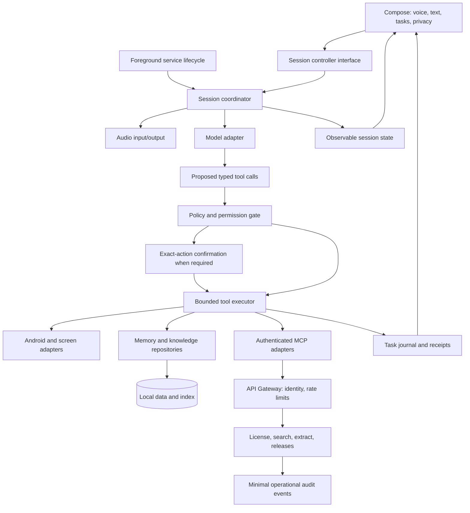

# Agar main Ultron banata

6 November 2026 · Proposed design, not a description of existing implementation.

## Product promise

**“Bolo, kaam samjho, safely complete karo, aur result dikhao.”** Main Ultron ko phone-first personal assistant rakhta. Conversation natural ho, lekin action engine predictable ho. Hindi/Hinglish strong rahe; memory user-controlled ho; core tasks few but dependable hon.

Pehla version: voice/text, device utilities, reminders/calendar, screen-assisted workflows for selected apps, search, local memory and document Q&A. Main current code se incremental migration karta; working audio/retrieval/storage discard nahi karta.

## Proposed architecture

Diagram mein confirmation path sirf policy-required actions ke liye hai; low-risk allowed actions directly executor tak jaati hain. Model proposals policy decisions nahi hain.

## Components and ownership

| Component | Owns | Must not own |
|---|---|---|
| UI / ViewModels | User intent, display state, navigation | WebSocket/audio resource lifetime or direct tool side effects |
| SessionCoordinator | Session state machine, reconnect, deadlines, cancellation, turn IDs | Licensing database or giant switch of Android APIs |
| ModelAdapter | Provider protocol, audio/text/tool messages, typed failures | Authority to bypass tool policy |
| ToolRegistry | Schema, handler, risk, permissions, timeout, idempotency policy | UI strings duplicated across many files |
| PolicyEngine | Allowed tools, trusted intent, app/lock state, scoped grants | Prompt-text heuristics as sole authorization |
| PermissionBroker | Request/result association and pending operation | Assuming one denial is permanent |
| ToolExecutor | Ordering, resource locks, retries, postconditions | Blind replay of unknown-outcome actions |
| TaskJournal | Operation status/receipt, minimal audit facts | Raw secrets or unlimited screen/audio history |
| MemoryRepository | Provenance, retention, edits/undo | Treating saved facts as instructions |
| KnowledgeRepository | Source documents, indexing/versioning, citations | Cross-model stale vector reuse |
| Backend | License transactions, public connector mediation, release metadata | Phone UI automation or unnecessary personal data aggregation |

Initially these can be packages with interfaces. Later module split: `:core:model`, `:core:policy`, `:core:storage`, `:voice`, `:tools:android`, `:tools:connectors`, `:feature:knowledge`, `:app`. Dependency arrows point inward to contracts. Avoid extracting every screen as a module.

## Execution model

Session states: Idle → Connecting → Listening → Thinking → Speaking; WaitingPermission / WaitingConfirmation / Reconnecting explicit branches. Stop transitions through Stopping to Idle. Only coordinator mutates resource state; UI observes.

Every operation has `operationId`, `sessionId`, `intentId`, tool/version, canonical args, risk, deadline, resource scope and outcome. Untrusted origin stays structured metadata through read → model → proposed action. A page saying “click Send” cannot create trusted user intent.

Example: “Kal 11 baje dentist reminder lagao.” Resolve date/time/timezone, create one reminder idempotently, show exact receipt. No unnecessary approval on clear low-risk command. Example: “Mera dentist event delete karo.” Resolve unique event and exact date; confirm that deletion; execute once; verify deleted or report unknown/failure. Screen tool can't bypass this by clicking a destructive button; screen workflows need app/action policy too, otherwise confirmation gate is incomplete.

Concurrent searches permitted under bounded semaphore. Screen actions serialized per active window/session; before action verify package/window and target identity. If layout changed, re-read. Run step/time limit prevents endless click loops. Cancellation stops queued operations; outcome of already dispatched mutation is reconciled rather than blindly retried.

Retry policy: safe reads can back off with jitter and deadline; writes need idempotency key or explicit reconciliation. Crash after dispatch before acknowledgement yields `UNKNOWN`, never auto-success. Local task journal supports restart reconciliation without replaying every operation.

## Memory / RAG design

Keep ObjectBox/hybrid retrieval unless benchmarks show a concrete problem. Store document ID, content revision, chunk ID, embedding model/dimension and indexing status. Atomic revision publication keeps retrieval and citation text consistent. Partial import remains visibly indexing, not silently searchable as complete.

Memory item: fact, source session/manual entry, created/updated time, sensitivity/retention policy, user-confirmed status where needed. Existing removed-memory restore is a good base. Sensitive identifiers/credentials should not become general memory. Private sessions don't persist history or extracted memory; remote inference disclosure remains.

Retrieval: lexical/vector fusion, bounded context, source diversity, citations with stable document anchors. Cache query embeddings only with provider/model isolation and privacy-aware retention. Evaluate against a versioned mixed-language question set. For “list all” requests, expose coverage limits instead of pretending top-k retrieval guarantees completeness.

## Backend and licensing

Keep the existing serverless shape. Explicit per-environment names/config. Firebase identity and App Check complement application authorization; neither alone proves entitlement.

License repository owns conditional activation transaction, status/version checks, cooldown and durable idempotent admin mutations. Account/device recovery is a product flow, not 'paste secret until it works'. Signed bounded offline leases can improve clarity and tamper detection, but no client-only scheme prevents a fully patched app from ignoring checks. Server-paid capabilities need server-side entitlement and quotas if introduced later.

BYOK mode remains direct-to-provider for voice; don't add a proxy merely for architectural symmetry. Managed AI option is a future separate billing/security design: backend controls credentials/session entitlement/quotas; transport choice requires provider capability validation before implementation. This report doesn't assume any particular ephemeral-token feature exists.

Admin: cursor-based listings, minimal PII, verified role/allowlist, change audit, idempotent key batches, explicit revoke/move actions. Separate deployment privileges from everyday support privileges as team grows.

Release: immutable artifacts with version/source digest, dedicated production signing, internal → beta → stable promotion, compatibility minimums, staged rollout and emergency disable mechanism. Recovery usually means a higher-version hotfix/re-promotion with compatible data—not promising unrestricted APK downgrade. No remotely editable policy may expand permissions silently.

## Features by phase

| Phase | What I ship | Done when |
|---|---|---|
| Foundation | Existing voice + BYOK setup + trustworthy license + permission broker + task receipts | Core journeys reliable on representative devices, races blocked |
| Daily use | Reminders, calendar, selected screen workflows, private mode, clear error recovery | Reboot/network/lock/duplicate tests pass; users can inspect/cancel tasks |
| Personal knowledge | Source-open citations, memory provenance/expiry, export/delete, text fallback | Evaluated grounding and consistent index/deletion behavior |
| Controlled routines | Explicit triggers/allowed actions/limits with preview and history | No hidden rules; each routine can be paused/revoked |
| Optional expansion | Selected connectors, encrypted multi-device sync, local wake-word/offline utilities | Demonstrated demand and measured operational/privacy costs |

## Testing and observability I'd build

Pure tests for state transitions, authorization and recurrence; deterministic fake provider for tool/error/cancel sequences; concurrency tests for licenses; adapter contract tests for MCP and storage; representative on-device journeys for accessibility/audio/permissions. Add delivered OTA-build smoke tests, not only debug logic tests.

Fault injection: provider timeout after mutation, duplicate frames, revoke during activation, stop during download, stale screen, permission denial, process death, storage-full and changing document revision. Test hostile retrieved instructions without using real user data/accounts.

Measure turn stages with existing latency IDs, redact content by default, keep telemetry opt-in/clearly disclosed. Action success comes from tool postconditions. Task failure categories actionable hon. Performance work begins with low/mid-range phone baseline; no theoretical architecture diagram proves low latency.

## My strongest design decision

Ultron ki intelligence model se aa sakti hai, **lekin permissions, exact action execution, storage consistency aur truth of completion code enforce kare**. Isse capability grow kar sakti hai without making every new connector another uncontrolled pathway. Current working parts ko preserve karke isi boundary ko strong banana meri first engineering investment hoti.
