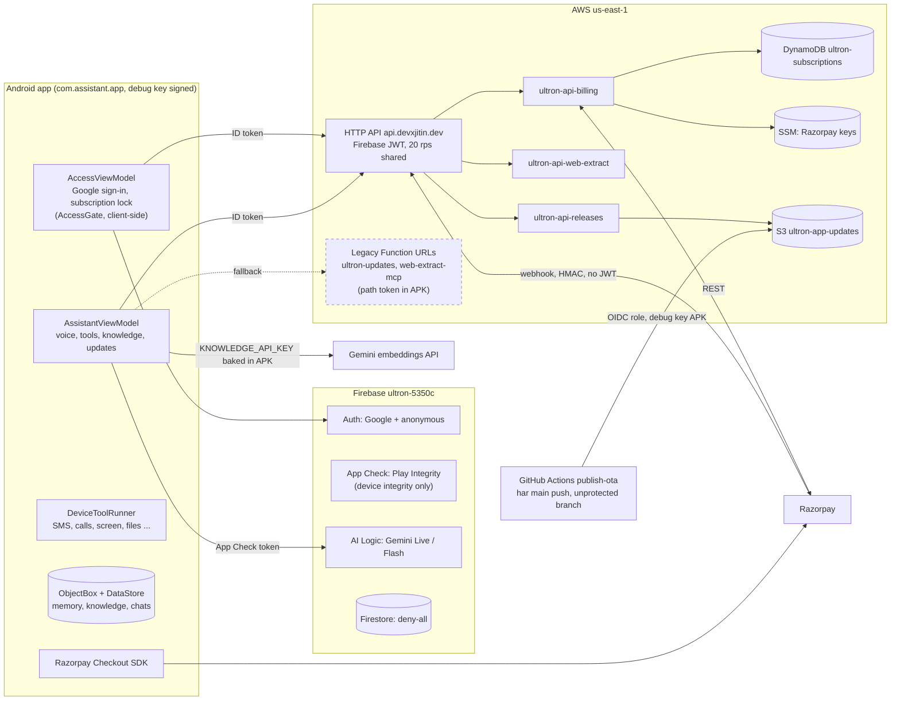
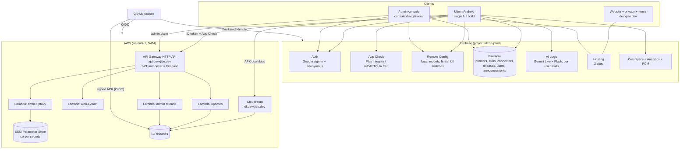
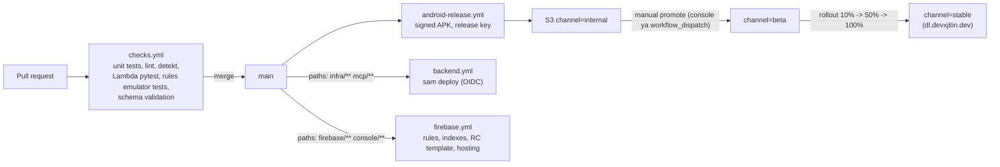
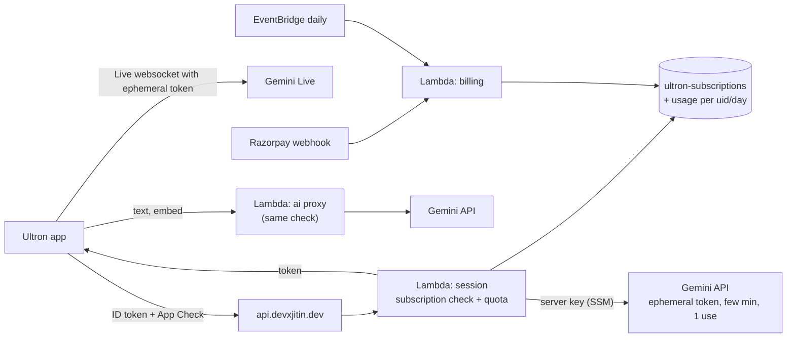

# Ultron, production architecture (v2)

Pehla review 2026-11-02, checkout `6fbc1f4`. Doosra review (security, payment, architecture) 2026-11-02, checkout
`2640d3c` (main), section 20 me. Ye document poore project ka review hai (Android app, connectors, permissions, AWS,
Firebase, CI/CD, Razorpay billing) aur production-ready architecture ka plan.

Section 3 ke findings pehle review ke hain, unka aaj ka status section 20.1 me hai. Section 6 aur 18 (remote content,
console) section 19 ke decision se wapas liye gaye, wo sirf history ke liye rakhe hain.

---

## 1. Short me verdict (2026-11-02, doosra review)

Pehle review ke baad bahut kuch theek ho gaya: Firebase Auth (Google sign-in), App Check (AI Logic par enforced), API
Gateway + Firebase JWT, AWS root se IAM user, Firestore deny-all, PR checks. Ab sabse bade risk **paise ke** hain, code
ke nahi:

- Subscription lock sirf app ke andar hai. Gemini call phone se seedha Firebase AI Logic jaati hai, to patched APK ya
  App Check ke kamzor setting (sirf device integrity) ke saath bina paise ke Gemini chal sakta hai. Bill aapka.
- `KNOWLEDGE_API_KEY` (aur `GEMINI_API_KEY`) build time par APK me baked hote hain. Section 19 ka step 2 karte hi ek
  asli Gemini key APK me chali jayegi.
- Billing Lambda me double charge aur "paisa kata par app locked" wale raaste hain, aur webhook miss ho to user hamesha
  active reh sakta hai (section 20.2).
- `main` branch protected nahi hai aur har push debug key se sign hokar sab phones par jaata hai. GitHub account gaya
  to malicious update sab phones par, jinke paas SMS, call aur accessibility permission hai.
- Purani Function URLs (path token APK me) abhi bhi live hain.

Fix ka order section 20.4 me hai.

---

## 2. Current architecture (2026-11-02, `2640d3c`)



Gemini traffic AWS se nahi guzarta, isliye server ko pata hi nahi ki kaun kitna use kar raha hai aur kaun paid hai.
Ye section 20 ka sabse bada point hai.

---

## 3. Review findings (pehla review, status section 20.1 me)

Severity: **P0** = users ko dene se pehle zaroor, **P1** = production quality ke liye, **P2** = cleanup.

### 3.1 Security aur accounts

| # | P | Kya mila | Kahan | Fix |
|---|---|---|---|---|
| S1 | P0 | AWS CLI root account (`arn:aws:iam::143920986615:root`) se chal raha hai. Root par MFA on hai aur root access keys nahi hain (Phase 0 me check kiya), lekin daily kaam root se nahi hona chahiye | `aws sts get-caller-identity` | Identity Center ka instance "account instance" hai, wo permission sets support nahi karta, to CLI SSO nahi chalega. Ya to IAM user (MFA ke saath, `aws login`) banao, ya AWS Organizations on karke organization-instance Identity Center. Dono aapko khud karne honge (credentials/accounts) |
| S2 | P0 | Firebase AI Logic par App Check nahi, koi Auth nahi | `FirebaseGemini.kt`, `FirebaseLiveClient.kt` | App Check (Play Integrity) enforce, Firebase Auth, AI Logic me per-user rate limit |
| S3 | P0 | APK me secrets: `UPDATE_URL` aur `WEB_EXTRACT_URL` ke path tokens | `build.gradle.kts` `buildConfigField` | Path token hatao, har request Firebase ID token + App Check token se verify ho (section 5.3) |
| S4 | P0 | OTA APK debug keystore se sign (password `android`), CI secret me bhi wahi | `build.gradle.kts` `ota` build type, `publish-ota.yml` | Asli release key (Play nahi, website se distribute karna hai, section 15). Key badalne par ek baar naya install karna padega, package rename karna ho to usi time (section 7.4) |
| S5 | P0 | Lambda Function URLs `AuthType: NONE`, sirf path token | `infra/ultron.yaml` | API Gateway HTTP API + JWT authorizer (Firebase issuer) + throttling |
| S6 | P1 | Firebase API key Google Cloud me unrestricted lag rahi hai | GCP Credentials page | Key ko Android app (package + SHA-256) aur hosting domains tak restrict karo, sirf zaroori APIs allow |
| S7 | P1 | Firestore me revert ke baad bhi purane rules/data deployed ho sakte hain (`remote/prompts` public read) | Firebase console | Naye rules deploy karo (section 6.4), purana data hatao ya migrate |
| S8 | P1 | `isAccessibilityTool="true"` set hai | `accessibility_service_config.xml` | Play policy ab lagu nahi (website distribution). Flag rehne do, lekin onboarding me accessibility ka prominent disclosure phir bhi rakho |

### 3.2 Android permissions

| # | P | Problem | Kahan | Fix |
|---|---|---|---|---|
| A1 | P0 | Tool permission dialog ka result ignore hota hai. User Allow kare ya Deny, tool retry nahi hota, model ko pata nahi chalta, aur "Don't ask again" ke baad dialog aata hi nahi (silent no-op) | `MainActivity.kt:191` (`toolPermissionLauncher` callback khali) | `PermissionBroker` (section 7.3): result ko suspend karke tool tak wapas do, denied-permanently par App info deep link |
| A2 | P0 | Voice session background ya lock screen par ho to permission dialog dikh hi nahi sakta, kyunki launcher Activity ki composition me hai | `AssistantViewModel.kt:1069`, `MainActivity.kt:276` | Activity na ho to notification + transparent `PermissionActivity` |
| A3 | P0 | Android 13+ par sideloaded app ke liye Accessibility aur Notification access "restricted settings" se block. Ye guidance sirf model ke tool result text me hai, Connectors page par nahi | `DeviceToolRunner.kt:958`, `:1170` | Connectors onboarding me step: App info kholo, "Allow restricted settings", phir toggle |
| A4 | P1 | Android 14+ par `SCHEDULE_EXACT_ALARM` naye installs par default denied, code chup-chaap inexact alarm laga deta hai, reminder late bajta hai | `AutomationEngine.kt:211` | Reminder connector add karte waqt `ACTION_REQUEST_SCHEDULE_EXACT_ALARM`, state-change broadcast suno, UI me "Exact alarms off" dikhao |
| A5 | P1 | Calls connector ek saath `CALL_PHONE`, `ANSWER_PHONE_CALLS`, `READ_CALL_LOG`, `READ_CONTACTS` maangta hai | `ConnectorsPage.kt:198` | Just-in-time: har tool apni permission use ke waqt maange, rationale ke saath |
| A6 | P1 | Notification aur mic permission pehli launch par bina context ke maange jaate hain | `MainActivity.kt:209-217` | Onboarding screens (kyun chahiye, phir maango) |
| A7 | P1 | Permission aur connector catalog UI file ke andar hai (773 line ka `ConnectorsPage.kt`) | `ConnectorsPage.kt:152-210` | `ConnectorRegistry` me descriptors (section 7.2) |
| A8 | P1 | Play me ye restricted hoti, website distribution me policy ka dar nahi: `READ_SMS`, `SEND_SMS`, `READ_CALL_LOG` (default handler na ho to reject), `REQUEST_INSTALL_PACKAGES` (self-update allowed nahi), `READ_MEDIA_*` broad access, Accessibility automation | Manifest | Ek hi `full` build, `devxjitin.dev` se. Play flavor ki zaroorat nahi (section 15) |
| A9 | P2 | `targetSdk 35`, compileSdk 36 | `build.gradle.kts` | Naye Android versions ke behaviour changes se pehle 36 par le jao, test karke |
| A10 | P2 | Boot par FGS start: Android 15 `BOOT_COMPLETED` se microphone type FGS allow nahi karta. Abhi code specialUse se start karta hai, sahi hai, bas regression test chahiye | `BootReceiver.kt`, `AppForegroundService.kt:95` | Test case + comment |

### 3.3 Connectors aur tools

| # | P | Problem | Fix |
|---|---|---|---|
| C1 | P1 | Connector ka data 4 jagah bikhra hai: `PhoneConnectors.kt`, `ConnectorsPage.kt` catalog, `McpTools.kt`, `AppSettingsStore` | Ek `ConnectorRegistry`, har connector ek descriptor + handler |
| C2 | P1 | Knowledge base ke liye user se alag "Knowledge API key" maangi jaati hai. Normal user ke liye ye dead end hai | Embeddings server-side proxy se (section 5.3), user key sirf optional "bring your own key" |
| C3 | P1 | GitHub connector PAT ya device flow token sirf phone par, `GITHUB_CLIENT_ID` build time par baked | Theek hai, lekin client id remote config me aaye. Token phone par hi rahe |
| C4 | P1 | Google Workspace Lambda deployed hai par app me wired nahi. Gmail ke scopes "restricted" hain, Google verification + CASA security assessment chahiye jo free nahi | Gmail drop karo. Calendar on-device already hai. Drive/Docs chahiye to Android Authorization API se "sensitive" (restricted nahi) scopes, phir verification |
| C5 | P2 | MCP client protocol `2025-03-26` aur sirf static header auth | Future third-party MCP connectors ke liye MCP OAuth (newer spec) support |
| C6 | P1 | Kisi tool ko production me band karne ka tareeka nahi (bug aaye to nayi APK) | Remote Config `tools_disabled` kill switch |

### 3.4 App code aur workflow

| # | P | Problem | Fix |
|---|---|---|---|
| W1 | P1 | `AssistantViewModel` 2484 lines, voice session ka lifecycle ViewModel me. Activity task hatte hi ViewModel clear, session khatam, chahe FGS chal raha ho | Session `VoiceSessionService` (bound FGS) me, ViewModel sirf state observe kare (section 7.1) |
| W2 | P1 | Ek single `:app` module, DI nahi, `DeviceToolRunner` 1457 lines | Gradle modules + Hilt |
| W3 | P0 | `main` par har push sab phones par publish, tests run hi nahi hote (`publish-update.ps1` sirf `assembleOta`) | PR checks + channels (internal, beta, stable) + staged rollout (section 8) |
| W4 | P1 | Models, voices, languages, session limits, prompts, skills, greetings sab hardcoded | Remote Config + Firestore (section 6) |
| W5 | P1 | Crash aur usage ki koi visibility nahi, `UsageStore` sirf local | Crashlytics + Analytics (free) |
| W6 | P1 | `infra/ultron.yaml` deployed nahi, live resources haath se bane, `web-extract-mcp` template me hai hi nahi | Pura AWS SAM se (section 5.4) |
| W7 | P2 | `publish-update.ps1` me bucket naam account id ke saath hardcoded | SAM outputs / SSM parameter se |
| W8 | P2 | AWS account me Ultron se alag cheezein bhi hain (`future-self-booth-api`, `nira-updates`, `age-prediction-code`) | Tags + alag stacks, chaho to AWS Organizations me alag account |

### 3.5 Pichla web panel revert kyun sahi tha

Reverted panel me ye kamiyan thi, naya design inhe theek karta hai:
- Rules me owner ka email hardcoded tha (`isOwner()`), roles nahi the.
- `remote/prompts` sabke liye public read tha, bina Auth ya App Check.
- Draft, publish, rollback ya history kuch nahi tha. Galat edit seedha sab phones par.
- Schema teen jagah alag-alag (rules, `RemoteSnapshot`, `web/app.js`), koi shared contract nahi.

---

## 4. Target architecture



### 4.1 Kaam ka bantwara (kaun kya karega)

| Layer | Zimmedari | Kyun ye choice |
|---|---|---|
| **Android app** | Voice loop, device tools, on-device memory/knowledge/chats, offline defaults | Privacy: personal data phone par hi rahe. Latency: Gemini Live seedha phone se |
| **Firebase** | Identity, App Check, config, content, admin console hosting, crash/analytics, push | Spark plan par free, Android SDK native, realtime config updates, offline cache built-in |
| **AWS** | Server-side compute jisme secret chahiye, APK delivery, release pipeline | $100 credits + Lambda always-free 1M requests + CloudFront always-free 1 TB. Existing Lambdas aur OIDC role reuse |
| **Website + CloudFront** | APK distribution, in-app updater, SHA-256 download page | Aapka decision: Play Store par nahi jana. Full control, koi Play policy nahi, lekin trust aur update ka kaam khud sambhalna hai |
| **devxjitin.dev** | Website, console, API, downloads | Ek brand, saare endpoints HTTPS (`.dev` HSTS preloaded hai) |

Firebase Cloud Functions jaan-boojh kar **nahi** liye: unke liye Blaze plan chahiye. Server code AWS Lambda par
rahega jahan credits hain. Firebase Spark par hi rahe (free), jab tak Gemini ka paid quota na chahiye (section 10).

---

## 5. Backend design

### 5.1 Identity

- **Firebase Auth**: Google sign-in (Credential Manager se) primary. Pehli launch par anonymous sign-in, taaki bina
  account ke bhi app chale, baad me Google account se link (`linkWithCredential`), data uid ke saath rehta hai.
- **Roles** custom claims me: `admin`, `tester`. Email hardcode nahi. Claim set karne ke liye ek chhota script
  (`scripts/set-role.mjs`, Admin SDK, aapke local Firebase login se) ya admin Lambda.
- **App Check**: Android par Play Integrity provider, lekin app Play se install nahi hogi, isliye console me `PLAY_RECOGNIZED` required na rakho, sirf device integrity (section 15). Console par reCAPTCHA Enterprise. Enforcement on: AI Logic,
  Firestore, aur AWS API (Lambda me App Check JWT verify).

### 5.2 Gemini access

- Voice (Live) aur text dono **Firebase AI Logic** se, Gemini Developer API backend. Server key kabhi phone par nahi.
- AI Logic console me **per-user rate limit** set karo (Auth ke baad ye per-uid lagta hai).
- "Bring your own key" Developer settings me optional rahe, power users ke liye. Default path hamesha Firebase.
- Model IDs Remote Config se (`live_model_default`, `live_models_allowed`, `text_model`), taaki model retire ho to
  bina APK badle switch ho jaye.

### 5.3 AWS API (`api.devxjitin.dev`)

Ek **API Gateway HTTP API**, ek custom domain, versioned routes. JWT authorizer issuer
`https://securetoken.google.com/<project-id>`, audience `<project-id>`. HTTP API ye natively support karta hai, to
Firebase ID token ka verification bina code ke ho jaata hai. App Check token ek shared Lambda helper verify karega.

| Route | Lambda | Auth | Kaam |
|---|---|---|---|
| `GET /v1/releases/latest?channel=beta` | `releases` | user | Channel ka latest build + CloudFront URL |
| `POST /v1/web/extract` | `web-extract` | user | Existing trafilatura code, SSRF checks same rehenge |
| `POST /v1/embed` | `embed` | user | Gemini embedding proxy, server key SSM se, per-uid daily quota (DynamoDB on-demand ya Firestore counter) |
| `POST /v1/admin/releases` | `admin` | `admin` claim | Release promote, rollout %, notes |

- Throttling: stage level (jaise 20 rps burst 40) + per-route.
- Secrets: **SSM Parameter Store SecureString** (standard tier free). Secrets Manager $0.40/secret/month, zaroorat nahi.
- MCP: web-extract ko MCP shape me hi rakh sakte ho (`McpClient` reuse hota hai), bas URL `api.devxjitin.dev/v1/mcp/web`
  aur auth header Bearer ID token.
- `google-workspace-mcp` aur purane Function URLs hata do jab naya API live ho.

### 5.4 Infra as code

- **AWS SAM** (`infra/template.yaml`): API, 4 Lambdas (Python 3.13, arm64), S3 releases bucket, CloudFront + OAC,
  ACM certs, log groups (14 din retention), budget alarm. SAM isliye kyunki code Python Lambdas hai aur existing
  CloudFormation template seedha SAM me badal jaata hai. Ek stack per environment: `ultron-dev`, `ultron-prod`.
- **Firebase**: `firebase/firebase.json`, `firestore.rules`, `firestore.indexes.json`, `remoteconfig.template.json`,
  sab git me, `firebase deploy` CI se.
- Do Firebase projects: `ultron-dev` (emulators + testing) aur `ultron-prod`. Existing `ultron-5350c` ko prod bana
  sakte ho ya fresh project, mera suggestion fresh `ultron-prod` (clean rules, clean data, sahi package name ke saath).

---

## 6. Kya cheez remote se aayegi (hardcoded nahi)

Rule ye hai: **jo cheez product ka behaviour hai aur sab users ke liye same hai, wo remote. Jo user ka private data ya
secret hai, wo kabhi console me nahi.** Har remote value ka ek bundled default APK me rahega, taaki offline aur pehli
launch par bhi app chale.

### 6.1 Remote Config (chhote values, flags, rollout)

Remote Config isliye kyunki free hai, conditions (app version, country, % users, user property "tester") built-in hain,
real-time updates hain, aur Firebase console me history/rollback pehle se hai.

| Key | Type | Example |
|---|---|---|
| `min_supported_version` | int | Isse purana build force-update screen dikhaye |
| `live_model_default`, `live_models_allowed` | string, JSON | Model switch bina APK |
| `text_model`, `embedding_model` | string | |
| `voices`, `languages` | JSON | 30 voices, 13 languages ki list |
| `session_max_minutes`, `idle_timeout_seconds`, `turn_timeout_seconds` | int | Abhi `AssistantViewModel` companion me hardcoded |
| `retrieval_chunk_limit`, `max_tool_result_chars` | int | |
| `tools_disabled` | JSON array | Kill switch, jaise `["send_sms"]` |
| `connectors_enabled` | JSON | Connector globally on/off, `minVersion` ke saath |
| `github_client_id` | string | `BuildConfig` se bahar |
| `update_check_minutes` | int | |
| `prompt_version`, `skills_version` | string | Firestore ka kaunsa published version use ho |

### 6.2 Firestore (bada text, versioned content, users)

```
config/active                     { promptVersion, skillsVersion, updatedAt, updatedBy }
prompts/{versionId}               { persona, policy, greeting, documentFormatPrompt, status: draft|published,
                                    minAppVersion, createdBy, createdAt, note }
skills/{versionId}/items/{name}   { description, body, tasks: {...}, minAppVersion, locked: false }
connectors/{id}                   { title, description, permissionText, privacyText, kind, minAppVersion }
releases/{versionCode}            { versionName, channel, rolloutPercent, notes, sha256, size, createdAt }
announcements/{id}                { title, body, audience, startsAt, endsAt, minAppVersion }
users/{uid}                       { createdAt, plan, roles (read-only mirror), lastSeenVersion, banned }
users/{uid}/private/quota         { day, voiceSeconds, textCalls, embedCalls }   // sirf server likhe
auditLog/{id}                     { actor, action, target, before, after, at }
```

- **Publish model**: console me draft banta hai, preview hota hai, "Publish" par `config/active` ka pointer badalta
  hai. Rollback = pointer purane version par. Phone par listener sirf `config/active` dekhta hai, phir wo version
  ek baar fetch karke cache karta hai, to reads bahut kam (Spark ke 50k/day me aaram se).
- `ultron-features` jaisi locked skills APK me hi bundled rahengi, remote unhe override nahi kar sakta (pichla decision same).
- **Contract**: `contracts/*.schema.json` (JSON Schema) ek jagah. Console `ajv` se validate kare, Firestore rules
  size/type check karein, Android parser defensively parse kare aur galat value par bundled default le. Ek CI test
  bundled defaults ko schema se validate kare.

### 6.3 Console me kya nahi hoga

User ki memory, knowledge documents, chats, user ki API keys, GitHub tokens, signing keys, server secrets. Ye kabhi
Firestore me nahi jayenge. Isse privacy story simple rehti hai, aur privacy policy likhna bhi.

### 6.4 Firestore rules ka shape

```
function signedIn() { return request.auth != null; }
function isAdmin()  { return signedIn() && request.auth.token.admin == true; }

match /config/{doc}            { allow read: if signedIn(); allow write: if isAdmin(); }
match /prompts/{v}             { allow read: if signedIn() && resource.data.status == 'published' || isAdmin();
                                 allow write: if isAdmin() && validPrompt(); }
match /skills/{v}/items/{n}    { allow read: if signedIn(); allow write: if isAdmin() && validSkill(); }
match /releases/{v}            { allow read: if signedIn(); allow write: if false; }   // sirf admin Lambda
match /users/{uid}             { allow read: if request.auth.uid == uid || isAdmin();
                                 allow update: if request.auth.uid == uid && onlyProfileFields(); }
match /users/{uid}/private/{d} { allow read: if request.auth.uid == uid; allow write: if false; }
match /auditLog/{id}           { allow read: if isAdmin(); allow write: if false; }
```

App Check enforcement Firestore par on hoga, to bina genuine app ke read bhi nahi. Rules ke tests Firebase emulator par
CI me chalenge.

### 6.5 Admin console (`console.devxjitin.dev`)

- Stack: **Vite + React + TypeScript + Firebase JS SDK**, Firebase Hosting. Koi server nahi, sab rules aur admin claim se secure.
- Pages: Dashboard (active version, crash-free %, links), Prompts (editor, diff, publish, rollback), Skills, Connectors,
  Feature flags (Remote Config REST API se, ya pehle phase me Firebase console ka link), Releases (channel, rollout %,
  promote), Announcements, Users (role, ban), Audit log.
- Login sirf Google, `admin` claim na ho to "Not authorized".

---

## 7. Android app ka naya structure

### 7.1 Modules

```
android/
  app/                    entry, DI graph, navigation, build types (debug/ota/release)
  core/model/             data classes, ToolResult, ConnectorDescriptor
  core/data/              DataStore, ObjectBox (memory, knowledge, chats), EncryptedPrefs
  core/remote/            RemoteConfigRepository, ContentRepository (Firestore), bundled defaults
  core/network/           OkHttp, ApiClient (ID token + App Check interceptor), McpClient
  core/ai/                LiveClient interface, FirebaseLiveClient, GeminiLiveClient (BYOK), TextClient
  feature/voice/          VoiceSessionService, SessionController, audio (MicStreamer, AudioPlayer), UI
  feature/tools/          ToolRegistry, ToolHandler per group (calls, sms, calendar, screen, ...)
  feature/connectors/     ConnectorRegistry, ConnectorsScreen, PermissionBroker
  feature/knowledge/      import, chunking, embedding (via api), search
  feature/memory/, feature/settings/, feature/updates/
```

- **Hilt** for DI, isse `AssistantViewModel` ke 20+ dependencies constructor se aayengi aur test aasaan hoga.
- **VoiceSessionService**: bound foreground service jo `SessionController` ka owner hai. Activity band ho, task swipe ho,
  phir bhi session sahi se chale ya clean band ho. ViewModel sirf `StateFlow` observe kare. Ye W1 ka fix hai.
- **WorkManager**: update check, embedding migration, APK download (abhi custom `DownloadService` hai).
- **ObjectBox rakho**: on-device HNSW vector index already chal raha hai, isko Room se badalne ka koi faayda nahi.

### 7.2 ConnectorRegistry aur ToolRegistry

```kotlin
data class ConnectorDescriptor(
    val id: String,
    val tools: List<ToolSpec>,
    val runtimePermissions: List<PermissionSpec>,   // har tool ki apni, just-in-time
    val specialAccess: SpecialAccess?,              // ACCESSIBILITY, NOTIFICATION_LISTENER, USAGE, EXACT_ALARM, WRITE_SETTINGS, DND
    val minSdk: Int = 26,
)

interface ToolHandler {
    val specs: List<ToolSpec>
    suspend fun run(name: String, args: JsonObject, ctx: ToolContext): ToolResult
}
```

Text (title, description, privacy line) Firestore `connectors/{id}` se, logic code me. Tool declarations Gemini ko
`ToolRegistry` se jaayengi, `tools_disabled` filter lagake.

### 7.3 PermissionBroker

```kotlin
interface PermissionBroker {
    /** Suspends until the user answers. Shows the dialog if an activity is visible, otherwise a notification. */
    suspend fun request(perms: List<String>, rationale: String): PermissionOutcome   // GRANTED, DENIED, DENIED_FOREVER
    fun openAppSettings()
    fun specialAccessState(access: SpecialAccess): AccessState
}
```

- Activity visible: `ActivityResultRegistry` se dialog, result `CompletableDeferred` se tool tak wapas. Tool phir
  retry kare aur model ko sahi status mile.
- Activity nahi: high-priority notification "Ultron ko Contacts permission chahiye", tap par transparent
  `PermissionActivity`.
- `DENIED_FOREVER` (shouldShowRationale false + denied): App info deep link.
- Special access ke liye guided steps, Android 13+ sideload par "Allow restricted settings" step pehle.

### 7.4 Build types, signing aur package name

Website distribution hai, to `play` flavor nahi banega. Ek hi build, teen build types: `debug`, `ota` (abhi ka naam, baad me `release`)
aur `release`. SMS, call log, accessibility automation aur `REQUEST_INSTALL_PACKAGES` sab rehte hain.

- **Release key:** asli keystore banao, password manager + offline backup me rakho, CI me base64 secret. **Ye key kabhi
  khoni nahi chahiye**, kyunki iske bina koi update nahi de sakte. Memory note wala "never replace" rule ab nayi key par lagega.
- **Key badalne ka asar:** abhi installed apps debug key se sign hain. Nayi key se signature match nahi hoga, to existing
  phones ko ek baar naya install karna padega (uninstall, install). Memory, knowledge aur settings ke export ka rasta pehle sochna hoga.
- **Package name:** `com.assistant.app` rakh sakte ho (Play par clash ka darr nahi). Rename karna ho to key badalne ke
  saath hi karo, taaki reinstall ek hi baar ho. Rename par naya Firebase app, naya SHA aur nayi `google-services.json` chahiye.
- **Update trust:** `latest.json` me sha256 already hai. Download page par bhi SHA-256 aur signing certificate fingerprint dikhao.

---

## 8. CI/CD aur release flow



- Abhi wala "har push sab phones par" khatam. `main` sirf internal channel tak jaata hai (aap aur testers). Rollout percent `releases/{versionCode}` me hai, updater apne device id ke hash se decide kare.
- Version code: `versionCode` ab CI run number se ya `git rev-list --count` se, minutes-since-1970 wala tareeka hata do.
- APK upload: GitHub OIDC se AWS role assume karke S3 par, `releases` Lambda `latest.json` aur channel update kare. Koi Play credentials nahi.
- Firebase deploy: GitHub OIDC se Google Workload Identity Federation, koi JSON key nahi.
- AWS: existing `ultron-ota-publish` OIDC role, SAM deploy ke liye permissions badhao, root kabhi CI me nahi.
- Path filters taaki web/infra change par APK na bane (pichle commit me ye sahi kiya tha, wahi rakho).

---

## 9. Domain plan (`devxjitin.dev`, name.com)

DNS name.com par hi rakho (free hai). Records:

| Host | Type | Target | Kya |
|---|---|---|---|
| `devxjitin.dev` | A / TXT | Firebase Hosting values | Website, privacy policy, terms (download page ke trust ke liye) |
| `www` | CNAME | Firebase Hosting | Redirect apex par |
| `console` | CNAME / A | Firebase Hosting (2nd site) | Admin console |
| `api` | CNAME | API Gateway regional domain | AWS API, ACM cert (DNS validation CNAME bhi name.com me) |
| `dl` | CNAME | CloudFront distribution | APK downloads, ACM cert us-east-1 me |

`.dev` HSTS preloaded hai, to har subdomain par HTTPS hi chalega, ye sab services wahi dete hain.

---

## 10. Cost (free kaise rahe)

| Service | Free kya hai | Ultron ka use |
|---|---|---|
| Firebase Auth | Spark par email/Google/anonymous free | Haan |
| App Check (Play Integrity) | Standard daily quota free | Haan |
| Remote Config, Crashlytics, Analytics, FCM | Free | Haan |
| Firestore | 50k reads, 20k writes, 1 GB per day/total | Version pointer + cache, kaafi hai |
| Hosting | 10 GB storage, ~360 MB/day transfer | 2 static sites |
| AI Logic (Gemini Developer API) | Free tier rate limits ke saath | Shuru me. Scale par Gemini paid billing chahiye, **asli kharcha yahi hoga** |
| AWS Lambda | 1M requests + 400k GB-s/month always free | Haan |
| CloudFront | 1 TB/month always free | APK downloads |
| API Gateway HTTP API | ~$1 per million requests | Credits se |
| SSM Parameter Store standard | Free | Secrets |
| S3 | Few GB, cents | Releases |

- AWS Budgets me $5 aur $20 ka alert lagao, aur Cost Anomaly Detection on karo.
- Agar AWS account naye "Free plan" (credits wale) par hai, to ye plan kuch mahino baad ya credits khatam hone par
  account band kar deta hai jab tak "Paid plan" par upgrade na karo. Billing console me plan type check kar lena.
- Gemini Live ka cost per-user voice minutes se badhta hai. Isliye Remote Config me per-user daily voice limit aur
  `users/{uid}/private/quota` pehle din se rakho. Paid tier ya subscription baad me isi par lagega.

---

## 11. Observability

- Crashlytics (crash + non-fatal, `UserFacingError` ke saath), Analytics events: `session_start`, `session_end`
  (duration, reason), `tool_call` (name, status, latency bucket), `connector_added`, `permission_outcome`.
  User ka content kabhi event me nahi.
- `LatencyTrace` ka data Firebase Performance custom traces me (`connect`, `first_audio`, `tool_roundtrip`).
- AWS: CloudWatch alarms Lambda errors aur 5xx par, logs 14 din.

---

## 12. Roadmap

| Phase | Kaam | Andaza |
|---|---|---|
| **0. Security** (ho gaya, section 13) | S1 root se IAM Identity Center, S6 API key restriction, S7 Firestore cleanup, Budgets alarm, `google-workspace-mcp` aur unused Function URLs band | 1 din |
| **1. Foundation** (code ho gaya, console steps aur key/package baaki, section 14) | Firebase Auth + App Check (app + AI Logic enforce), Crashlytics/Analytics, PR checks workflow, release keystore (naya package optional) | 1 hafta |
| **2. Backend (core done)** | SAM stack, `api.devxjitin.dev`, JWT authorizer, `releases`, `web-extract`, `embed` routes, app me `ApiClient`, path tokens hatao | 1 hafta |
| **3. Remote content (core done, section 17)** | `contracts/`, Remote Config template, Firestore schema + rules + emulator tests, `RemoteConfigRepository`/`ContentRepository` with bundled defaults | 1 hafta |
| **4. Console (started, section 18)** | `console.devxjitin.dev`: prompts, skills, connectors, releases, flags, audit log | 1-2 hafte |
| **5. App refactor** | Hilt, modules, `VoiceSessionService`, `ToolRegistry`, `ConnectorRegistry`, `PermissionBroker`, onboarding | 2-3 hafte (feature by feature, har step par tests) |
| **6. Website launch** | `devxjitin.dev` landing, download page (SHA-256, signing fingerprint), privacy policy, terms, Play Protect aur "unknown app" FAQ, in-app updater test, Android developer verification rules check | 1-2 hafte |

Har phase alag branch + PR, aur Phase 0 sabse pehle kyunki wo aaj ka risk hai.

---

## 13. Phase 0 status (2026-11-02)

Phase 0 ka kaam ho gaya hai, do cheezein aise hain jinhe aapne kiya aur maine console se verify nahi kiya (neeche likhi hain).

| Item | Status |
|---|---|
| Budget alarm | Ho gaya. Naya `ultron-monthly` $20 (credits count nahi hote). Alerts devxjitin@gmail.com par 25% ($5), 80% actual aur 100% forecast par. `trustid-monthly` ko haath nahi lagaya. Ye account-wide hai, kyunki is account me doosre projects bhi hain |
| Root account (S1) | Ho gaya. Root par MFA on, root keys nahi. CLI ab IAM user `jitin-admin` se chalta hai (`aws sts get-caller-identity` se verify kiya) |
| `google-workspace-mcp` | Reserved concurrency 0 hai, yaani koi request nahi chalegi. Function aur URL delete nahi kiye. Undo: `aws lambda delete-function-concurrency --function-name google-workspace-mcp --region us-east-1`. Phase 2 me delete hoga |
| `ultron-updates`, `web-extract-mcp` | Abhi band nahi, live app inhe use karti hai. Phase 2 me API Gateway par shift hone ke baad band honge |
| S6 API key restriction | Aapne Google Cloud Console me Android app (package `com.assistant.app` + debug key SHA-1) tak restrict ki. **Maine console se verify nahi kiya.** Phone par voice session chal jaye to sahi hai |
| S7 Firestore | Rules `firestore.rules` se deploy hue (sab read/write band). Bina login ke `remote/prompts` par `403 PERMISSION_DENIED` aata hai (verify kiya). Purana `remote` aur `remote_skills` data delete commands exit 0 se chale, **console me refresh karke confirm karna baaki hai** |
| `android/local.properties` | Stale `GOOGLE_MCP_URL` line hai (gitignored, app padhti nahi), aap hata sakte ho |

---

## 14. Phase 1 status (branch `phase1-foundation`)

Commits `194d203` (docs aur Firestore rules) aur `7e52801` (app code). Push ya PR abhi nahi hua, `main` par kuch nahi gaya.

| Item | Status |
|---|---|
| App Check in app | Code me. `UltronApp` startup par provider install karta hai. Debug build debug provider, OTA/release Play Integrity (`src/debug`, `src/ota`, `src/release` me `AppCheckInstaller`) |
| Firebase Auth | Code me. Anonymous sign-in startup par, Firebase config na ho to skip, fail ho to sirf log |
| Crashlytics, Analytics | Dependencies aur Gradle plugin add. Crashlytics plugin sirf tab lagta hai jab `google-services.json` ho |
| PR checks | `.github/workflows/checks.yml`, PR par unit tests, lint aur Lambda tests |
| Verification | `compileDebugKotlin`, `compileOtaKotlin` aur `testDebugUnitTest` pass. Lint aur phone par test nahi hua |
| Firebase console steps | **App Check aapne kiya, baaki confirm karo**: Anonymous auth enable, SHA-256 `FB:11:8C:42:FC:C4:E6:19:6F:34:9D:52:66:FE:C7:FD:6B:49:F6:E1:6C:EC:0C:B7:C0:E7:5B:4F:53:CB:D0:0C` Firebase app me add, App Check me Play Integrity register aur debug token add, Crashlytics enable |
| App Check verification | Ho gaya (2026-11-02). OTA build phone par chali, console me anonymous user aur verified App Check requests dono dikhe (aapne dekha). Maine console khud nahi dekha |
| App Check enforcement | **Ho gaya (2026-11-02).** AI Logic par enforce hai, sideloaded APK se voice session chal raha hai (user ne verify kiya), to device integrity token accept ho raha hai. Custom provider fallback ki zaroorat nahi. Firestore par zaroorat nahi, rules pehle se sab band karte hain |
| Release keystore | **Baaki.** Website distribution ke liye zaroori. Asli key banani hai, backup ke saath. Key badalne par ek baar reinstall |
| Package name | **Optional ab.** `com.assistant.app` rakh sakte ho. Rename karna ho to key badalne ke saath hi |
| Flavors | **Hata diya.** `play` flavor nahi banega, ek hi full build (section 15) |

**Dhyan:** `main` par push karte hi OTA APK sab phones par jaata hai (`publish-ota.yml`). Isliye PR banao, test karo, phir merge.

---

## 15. Distribution decision: website, Play Store nahi (2026-11-02)

Ultron Play Store par nahi jayega, APK `devxjitin.dev` (CloudFront, `dl.devxjitin.dev`) se milegi aur in-app updater se update hogi.

**Isse kya badla**
- `play` flavor, Play Console, Data safety form, Play App Signing sab hata diye. Ek hi `full` build.
- Play ki permission policy lagu nahi, to SMS, call log, accessibility automation aur self-update rehte hain.
- Phase 6 ab "Website launch" hai.
- Release key aur download page ka trust (SHA-256, fingerprint) ab hamari zimmedari hai.

**App Check ke liye zaroori setting**
- Firebase docs ke hisaab se built-in Play Integrity provider Play ke bahar install hui app ke saath bhi chal sakta hai, lekin default me `PLAY_RECOGNIZED` maangta hai jo website wali APK ko milega hi nahi.
- Console me **App Check > Apps > Play Integrity** me `PLAY_RECOGNIZED` aur `LICENSED` required mat rakho. Sirf **device integrity** rakho. TTL 1 ghanta.
- Ek doc (custom provider wala) kehta hai ki built-in provider sirf Play apps ke liye hai, dono docs me farak hai. **Enforce karne se pehle sideloaded APK se phone par test zaroor karo.** Fail ho to custom App Check provider (server-side, AWS Lambda) fallback hai.
- Rooted ya custom ROM phones ka device integrity fail ho sakta hai, to wahan Gemini access band hoga.

**Dhyan rakhne wali baatein**
- Play Protect "unknown app" warning dikha sakta hai, download page par FAQ rakho.
- Google ki sideloaded apps ke liye developer verification ki yojana hai. Timeline pakki nahi pata, `developer.android.com` par check karo, kyunki isse distribution ke rules badal sakte hain.

---

## 16. Phase 2 status (branch `phase2-backend`, 2026-11-02)

| Item | Status |
|---|---|
| API stack | Deploy ho gaya. CloudFormation stack `ultron-api` (`infra/api.yaml`, SAM template, SAM CLI ke bina `aws cloudformation package/deploy` se). 10 naye resources, purane resources me koi badlav nahi |
| API URL | `https://api.devxjitin.dev` (execute-api URL `https://uep4ytt3l9.execute-api.us-east-1.amazonaws.com` bhi chalta hai; HTTP API, Firebase JWT authorizer, throttle 20 rps burst 40) |
| Routes | `GET /v1/releases/latest` (Lambda `ultron-api-releases`), `POST /v1/web/mcp` (Lambda `ultron-api-web-extract`) |
| Auth test | Bina token aur fake token par `401` (verify kiya). Phone par asli Firebase token ke saath updater aur web reader chal gaye (user ne verify kiya, 2026-11-02) |
| Lambdas | Dono me `JWT_AUTH=1` mode. Purana secret-path mode as-it-is, to purani Function URLs aur purane phones nahi tootte |
| App | `ApiClient` (Firebase ID token), `AppUpdater` pehle API phir purana URL, `WebExtractClient` pehle API phir purana. `API_BASE_URL` build config me default set |
| Tests | Lambda tests 24 pass (2 naye JWT tests), `compileOtaKotlin` aur `testDebugUnitTest` pass |
| Custom domain | Ho gaya. `https://api.devxjitin.dev` live (ACM cert us-east-1, name.com par validation CNAME aur `api` CNAME). Bina token par dono routes `401` (verify kiya). App ka `API_BASE_URL` default isi par |
| `embed` route | **Baaki.** Server-side Gemini key chahiye (SSM SecureString), wo aap dogey |
| Purani Function URLs band karna | **Baaki.** Tab jab sab phones naye build par aa jayein |
| App Check token verification Lambda me | **Baaki.** Abhi sirf Firebase JWT check hota hai |

**Phase 2 core complete.** `embed` route aur App Check verification Lambda me Phase 3 ke saath hoga. Purani Function URLs tab band hongi jab sab phones naye build par aa jayein.

---

## 17. Phase 3 status (branch `phase3-remote-content`, 2026-11-02)

| Item | Status |
|---|---|
| `contracts/` | Ban gaya. `remote-config.schema.json`, `prompt.schema.json`, `config-active.schema.json` (JSON Schema 2020-12) |
| Remote Config template | `remoteconfig.template.json` repo me, defaults bundled defaults ke barabar. **Console me publish baaki** (`firebase deploy --only remoteconfig`) |
| Firestore rules | Naye rules likhe (config/prompts/skills/connectors/announcements/users/releases/auditLog, admin custom claim, published-only read, validation). **Deploy baaki**, abhi live rules deny-all hi hain |
| Rules tests | `rules-tests/` (emulator, 8 tests) aur contract tests (2 pass local). Emulator ko JDK 21 chahiye, local me 17 hai, to rules tests CI ke `firestore-rules` job me chalenge |
| Android | `RemoteSettings` (defensive parse, range clamp, bundled defaults), `RemoteConfigRepository` (hourly fetch, `UltronApp` se refresh), `tools_disabled` kill switch `DeviceToolRunner` me. 7 unit tests pass, `compileOtaKotlin` pass |
| Deploy | **Ho gaya (2026-11-02).** Firestore rules aur Remote Config template ultron-5350c par deploy hue. PR 21 `main` par merge, CI green (android, firestore-rules, lambdas) |
| Viewmodel jodna | Session max, idle, turn timeout, update check interval, tool result limit ab `RemoteSettings` se. Model list aur default model bhi (`AssistantOptions` ab Remote Config se allowed list leta hai, bundled list fallback) |
| Force update | `min_supported_version` build se bada ho to `ForceUpdateScreen` app ki jagah dikhti hai, button se update check aur install |
| ContentRepository | Firestore `config/active` se `promptVersion`, phir `prompts/{version}`, contract ke hisaab se validate (published, size, `minAppVersion`), last good prompt cache. User ne khud prompt likha ho to wo hi chalega. Abhi ek baar start par fetch hota hai (listener nahi, reads kam rakhne ke liye) |
| Admin claim aur seed | **Ho gaya (2026-11-02).** `devxjitin@gmail.com` par `admin: true` custom claim set, `prompts/v1` (bundled persona ki copy, published) aur `config/active` seed. Behaviour pehle jaisa rahega jab tak console se naya version publish na ho |
| Firestore App Check | **ENFORCED (2026-11-02).** Dhyan: future admin web console ko reCAPTCHA App Check chahiye hoga |
| Phone verify | **Ho gaya (2026-11-02).** `prompts/v2` publish karke `config/active` badla, phone par naya greeting aaya. Stored default prompt/greeting ab remote ko nahi dabate (PR 23) |
| Baaki | Skills ka remote version (locked skills bundled rahengi), `embed` route aur Lambda me App Check verification |

---

## 18. Phase 4 status (branch `phase4-console`, 2026-11-02)

| Item | Status |
|---|---|
| App | `console/` (Vite + React + TypeScript + Firebase JS SDK). Google login, `admin` claim na ho to "Not authorized" |
| Pages | Dashboard (active prompt, version count, shortcut links), Prompts (list, edit as new draft, publish, rollback, confirm dialog), Audit log |
| Publish model | Edit hamesha naya draft version banata hai. Publish ek batch me version ko `published` karta hai, `config/active` badalta hai aur audit entry likhta hai |
| Audit log | Rules ab admin ko append-only `create` dene dete hain (actor apna email, `update/delete` band). Rules tests update kiye |
| Hosting | Site `ultron-control` (`https://ultron-control.web.app`), headers: X-Frame-Options DENY, nosniff, no-referrer |
| App Check (web) | reCAPTCHA Enterprise key `ultron-console` (domains: console.devxjitin.dev, ultron-control.web.app, localhost), web app par register, Firestore enforcement ke saath chalta hai. Dev me debug token |
| Custom domain | `console.devxjitin.dev` Hosting me add hua. **name.com par CNAME baaki:** `console` -> `ultron-control.web.app` |
| Auth domain | `console.devxjitin.dev` authorized domains me add |
| Baaki | Skills, connectors, announcements, users pages. Releases/channel promote. Remote Config editor (abhi Firebase console ka link) |

---

## 19. Decision: sab hardcoded, console band, Razorpay subscription (2026-11-02)

Section 6 aur 18 ka remote-content plan wapas liya. Wajah ye thi ki non-technical user phone par prompt, API key ya
skills badal ke agent bigaad sakta tha, aur remote content ke liye console, rules aur contracts ka bojh bhi tha. Ab jo
cheez agent ka behaviour tay karti hai wo APK ke andar hai, aur badlav sirf naye build se jaata hai (merge to `main`,
CI OTA publish karta hai).

| Item | Ab |
|---|---|
| Prompt, naam, greeting, model, timeouts | Code me fixed (`AppSettingsStore`, `AssistantOptions`, `AssistantViewModel` constants). Remote Config aur Firestore app se hat gaye |
| Skills | Sirf `assets/skills/` wali built-in skills. Skills page, user skills aur on/off switch hata diye |
| API keys | `GEMINI_API_KEY` aur `KNOWLEDGE_API_KEY` `local.properties` se build time par. Developer page hata diya |
| User kya badal sakta hai | Connectors on/off, apna naam, voice, language, mic, barge-in, memories, knowledge documents |
| Console | `console/`, `contracts/`, `rules-tests/`, hosting config aur Remote Config template hata diye. Firestore rules ab deny-all |
| Releases | `ultron-api-releases` (`/v1/releases/latest`) rehta hai, OTA update isi se aata hai. Console wala admin Lambda kabhi `main` me nahi aaya |
| Login | Google sign-in (Credential Manager + Firebase Auth). Anonymous user ko link karke same uid rakha jata hai. Subscription Google account se judi hai, reinstall par wapas milti hai |
| Subscription | Razorpay: 1 month Rs 199, 6 months Rs 999, 1 year Rs 1799, auto-renew. Bina active plan ke app lock (koi free trial nahi) |
| Billing backend | `mcp/billing` Lambda (`ultron-api-billing`) + DynamoDB `ultron-subscriptions` (uid key). Routes `/v1/billing/status`, `subscribe`, `verify` (Firebase JWT) aur `webhook` (Razorpay signature, bina JWT) |
| Trust | Verify aur webhook dono Razorpay se subscription dobara padhte hain, request body par bharosa nahi. Checkout signature HMAC se check hota hai |
| Offline | Server ka last answer cache hota hai, paid cycle khatam hone tak offline bhi app khulti hai |

Setup jo abhi baaki hai (ek baar):

1. Firebase console me Authentication > Google provider on karo, OTA aur release keystore ka SHA-1 add karo, web client id
   ko `local.properties` aur CI secret `LOCAL_PROPERTIES` me `GOOGLE_WEB_CLIENT_ID=...` daalo.
2. ~~`KNOWLEDGE_API_KEY=...` bhi wahin daalo~~ **Mat karo** (2026-11-02 review, P2 in section 20.2). Ye key APK me
   plain text jaati hai. Embeddings `/v1/embed` proxy se aayenge.
3. Razorpay test keys se plans banao: `python scripts/razorpay-plans.py`, teen plan id milenge.
4. SSM me SecureString parameters: `/ultron/razorpay/key_id`, `key_secret`, `webhook_secret`.
5. `ultron-api` stack teen plan id parameters ke saath deploy karo.
6. Razorpay dashboard me webhook `https://api.devxjitin.dev/v1/billing/webhook`, subscription events, wahi webhook secret.

Status (2026-11-02): step 3, 4 aur 5 ho gaye (test mode). Plans `plan_TvLmXcUby3aa5w` (monthly),
`plan_TvLmXs3OS99lzM` (6 months), `plan_TvLmY52xpcSDdR` (yearly). SSM me teeno parameters, `ultron-api` stack deploy
(billing Lambda + table add, console wala admin Lambda hata). Step 6 (Razorpay webhook, test mode) bhi ho gaya. Step 1: Google provider pehle se on tha, `GOOGLE_WEB_CLIENT_ID`
local.properties aur CI secret me daal diya. Google sign-in ab phone par chal raha hai (purana Android OAuth client autourgos-491707 se hata kar Ultron project me banaya). Step 2
(`KNOWLEDGE_API_KEY`) baaki, uske bina knowledge search band rahega.

Seema: Gemini call Firebase AI Logic se seedha phone se jaati hai, to lock app ke andar hai, server par nahi. Patch kiya
hua APK lock tod sakta hai. Pakka server-side lock chahiye to Gemini ko apne backend ke peeche le jaana hoga (alag kaam).

---

## 20. Security aur payment review (2026-11-02, checkout `2640d3c`)

Is review me poora code padha gaya (Android app, `mcp/*` Lambdas, `infra/api.yaml`, workflows, scripts) aur GitHub repo
settings check ki. AWS, Firebase aur Razorpay console maine nahi dekhe, jo cheez sirf console me dikhti hai wo
"verify karna hai" likhi hai. Lambda tests (41) pass hain. Code me abhi koi change nahi kiya, sirf ye document.

Severity pehle jaisi hai. **P0** matlab paise ya users ka seedha nuksan, abhi theek karo. **P1** launch se pehle.
**P2** cleanup.

### 20.1 Pehle review ke findings ka status

| # | Ab | Note |
|---|---|---|
| S1 root account | Ho gaya | CLI `jitin-admin` IAM user se |
| S2 App Check, Auth | Ho gaya | AI Logic par App Check enforced, Google sign-in chalu. Lekin App Check sirf device integrity par hai (T4) |
| S3 secrets in APK | Aadha | API par shift ho gaya, lekin `UPDATE_URL`, `WEB_EXTRACT_URL` ab bhi APK me aur purani URLs live (T3). Upar se `KNOWLEDGE_API_KEY`/`GEMINI_API_KEY` naya risk (P2) |
| S4 debug key | Khula | OTA ab bhi debug key (password `android`) se. Local `local.properties` me release key ka config hai, lekin `ota` build use nahi karta |
| S5 Function URLs auth NONE | Aadha | Naya API JWT ke peeche, purani URLs live (T3) |
| S6 API key restriction | Aapne kiya, maine verify nahi kiya | |
| S7 Firestore | Ho gaya | Deny-all |
| W3 tests before publish | Aadha | PR par `checks.yml` chalta hai, lekin `main` protected nahi, to bina PR ke push bhi publish ho jaata hai (T1) |
| W6 IaC | Aadha | `infra/api.yaml` deployed, purane hand-made resources (`ultron.yaml`) nahi |

### 20.2 Payment aur subscription findings

| # | P | Kya mila | Kahan | Asar | Fix |
|---|---|---|---|---|---|
| P1 | P0 | Subscription lock sirf app me hai (`AccessGate.unlocked`, ek `@Volatile` boolean). Gemini call phone se seedha AI Logic jaati hai, server ko subscription ka pata hi nahi | `Subscription.kt:77`, `AssistantViewModel.kt:1247`, `:1866` | APK patch karke (ya repackage karke, agar App Check us signature ko accept kare) bina paise ke unlimited Gemini, bill aapka. Section 19 me bhi likha hai, lekin paid product ka ye sabse bada risk hai | Section 20.4, Gemini session server se milne wale short-lived token par jo sirf active subscriber ko mile. Tab tak AI Logic me per-user rate limit aur daily budget alert |
| P2 | P0 | `GEMINI_API_KEY` aur `KNOWLEDGE_API_KEY` `buildConfigField` se APK me plain string jaate hain. Abhi local me set nahi hain, lekin section 19 ka step 2 yahi karne ko kehta hai, aur CI ka `LOCAL_PROPERTIES` secret maine nahi dekha | `build.gradle.kts`, `AssistantViewModel.kt:164`, `:423` | Koi bhi APK (releases route kisi bhi Firebase user ko milta hai) kholke key nikaal le aur aapke Google Cloud billing par kuch bhi chalaye | Step 2 **mat karo**. Embeddings ke liye `POST /v1/embed` proxy (section 5.3 wala plan, key SSM me, subscription check ke saath). CI secret me agar ye keys hain to hatao aur key rotate karo |
| P3 | P0 | `status` route sirf DynamoDB padhta hai, Razorpay se kabhi dobara nahi. `_view` me status `active` ho to `currentEnd` dekha hi nahi jaata | `mcp/billing/lambda_function.py:121-136` | Renewal fail hua aur `halted`/`cancelled` webhook nahi pahuncha (API down, throttle, ya Razorpay ne baar-baar fail hone par webhook disable kar diya) to user hamesha active. Paisa nahi aaya, service chalti rahi | `currentEnd + grace < now` ho to `status` me Razorpay se subscription dobara padho aur record update karo. Daily EventBridge job jo saare active records reconcile kare. Webhook failure par CloudWatch alarm |
| P4 | P1 | `subscribe` purane subscription ko cancel kiye bina naya bana deta hai jab stored status `created`, `pending` ya `halted` ho. Do baar jaldi tap karne par do subscriptions | `lambda_function.py:139-160` | Purana mandate Razorpay par zinda rehta hai. `pending` retry ya baad me payment hone par user se do baar paisa kat sakta hai | Naya banane se pehle purana non-finished subscription `POST /subscriptions/{id}/cancel`. `created` wala ho to wahi dobara do. DynamoDB conditional write se race roko |
| P5 | P1 | Webhook ka "purana subscription naye ko overwrite na kare" rule stored `created` (abandoned checkout) ko bhi naya maanta hai, kyunki `created` `FINISHED_STATUSES` me nahi | `lambda_function.py:202` | User ne pehle wale subscription ka payment kiya (P4 jaisa case) to webhook ignore, paisa kata par app locked. Support ticket aur refund | Ignore sirf tab jab stored subscription khud paid (`active`/`authenticated`) ho. Ya P4 ke fix se ek user ka ek hi live subscription rakho |
| P6 | P1 | Poore API ka ek hi throttle (20 rps, burst 40), webhook bhi usi me. Anonymous Firebase account koi bhi bana sakta hai | `infra/api.yaml:74-76` | Koi bhi web-extract par flood karke billing aur Razorpay webhook ko `429` dila sakta hai. Webhook retry ke baad bhi fail ho to P3 wala hal | Webhook route ka alag, zyada limit. Web-extract ka per-route kam limit. Lambda me App Check check (T4) |
| P7 | P2 | SSM parameter missing ho to `_secret()` khali string deta hai aur HMAC khali key se banta hai | `lambda_function.py:54-63`, `:170`, `:182` | Webhook signature forge ho sakta hai. Asar kam hai kyunki status Razorpay se dobara padha jaata hai, lekin ye fail-open hai | Secret khali ho to `503` aur log, kabhi HMAC mat banao |
| P8 | P2 | Offline cache phone ki ghadi par chalta hai aur plain SharedPreferences me hai. Server unreachable ho aur cache active ho to app chalti rehti hai | `Subscription.kt:47-71`, `AccessViewModel.kt:66-81` | `api.devxjitin.dev` block karke (firewall app) aur ghadi peeche karke cancel ke baad bhi use. P1 ke saath milke chhota risk | Last successful server check se max 72 ghante offline grace. Server ka time (`Date` header) store karo |
| P9 | P2 | Refund ya chargeback ka koi handling nahi | `SUBSCRIPTION_EVENTS` | Refund ke baad bhi plan active | Refund par subscription turant cancel, ya `refund.processed` event par record update |
| P10 | P2 | Abhi test mode. Live par plan ids, keys, webhook secret sab naye honge. App me price (`BillingPlan`) hardcoded hai | `Subscription.kt:7-10`, `infra/api.yaml` params | Live plan ka price app se alag hua to user ko galat price dikhega | Live switch checklist (20.5). Price server se bhejo, ya CI test jo plan amount match kare |
| P11 | P2 | Razorpay timeout (`URLError`) ya missing field par unhandled exception, bina structured log ke `500`. Billing errors par alarm nahi | `lambda_function.py:216-227` | Payment ke waqt silent failures | `except Exception` par log aur `502`, CloudWatch metric filter aur alarm |

**Code fix status (2026-11-02, abhi deploy nahi hua).** `mcp/billing` me P3 (purana active record 2 din ke grace ke baad
Razorpay se dobara padha jaata hai, Razorpay down ho to user active hi rehta hai), P4 (same plan ka `created`
subscription reuse hota hai, `pending`/`paused` leftover cancel hota hai, missed payment par 409), P5 (paid subscription
kisi abandoned try ke upar bhi record hota hai), P7 (khali secret par `503`) aur P11 (network error par `502` aur log)
code me hain, 8 naye tests ke saath (suite 49 pass). **Baaki:** P3 ka daily reconcile job aur alarms, P4 ki
double-tap race ka DynamoDB conditional write (abhi sirf reuse se kam kiya hai), aur `ultron-api` stack redeploy.

**Doosra code fix (branch `api-hardening`, deploy nahi hua).** P3 ka daily sweep ban gaya (EventBridge `rate(1 day)` se
billing Lambda `reconcile_all()` chalata hai, test ke saath) aur P6 ke liye `infra/api.yaml` me route throttles hain
(web-extract 3 rps burst 10, webhook alag 20/40). Do baatein. Template maine `cfn-lint` ya `validate-template` se check
nahi kiya (AWS login nahi hai), deploy se pehle ye karna hai. Aur HTTP API ka default throttle shayad har route par alag
lagta hai, stage par shared nahi, to P6 ka "webhook ko starve karna" wala asar mere likhne se kam ho sakta hai. Web-extract
ka chhota limit phir bhi abuse ke liye sahi hai.

**Teesra code fix (branch `app-check-verify`, T4, deploy nahi hua).** `web-extract` aur `releases` Lambda ab
`X-Firebase-AppCheck` token verify karte hain (`mcp/*/appcheck.py`, sirf standard library, RS256 signature Google ki
JWKS se, issuer/audience/expiry). App `ApiClient` se token bhejti hai. **Mode `log` par default hai**, yaani missing ya
bad token sirf CloudWatch me likha jaata hai, request chalti hai, kyunki purane phones header bhejte hi nahi. Rollout:
deploy, kuch din log dekho (`App Check missing token` kam hote jaana chahiye), sab phones update hone par stack parameter
`AppCheckMode=enforce`. **Verify nahi hua:** verifier ko asli Google token se nahi chalaya (sirf apni test key ke saath
12 tests), to enforce se pehle log me `bad signature` ya `wrong audience` na dikhe ye zaroor dekho. Anonymous users ko
rokna aur billing route par check abhi nahi hai. Billing ko JWT hi kaafi hai kyunki Razorpay se khud verify hota hai.

**Chautha code fix (branch `sms-call-confirm`, T5 ka hissa, phone par test nahi hua).** `ActionGuard`: jab pichle 5
minute me koi untrusted text model tak pahuncha ho (SMS, notification, web page, YouTube, GitHub, jiska result "untrusted
content" marker ke saath aata hai), tab `send_sms`, `send_sms_contact`, `call_contact` aur `dial_number` ek on-screen
dialog (recipient aur poora message dikhta hai) par Allow ka wait karte hain. 45 second me tap na aaye, ya app screen par
na ho, to refuse, aur model ko `status=denied` milta hai. Voice "haan" kaafi nahi maana, kyunki wahi text use bol sakta hai.
**Abhi nahi hua:** accessibility write actions (click, type, tap) par confirmation, SMS counter (`SmsRules`) ka restart
par reset hona, aur naye ya international number par hamesha confirm. Screen tools ko jaan-boojh kar guard nahi kiya, kyunki
WhatsApp jaisi skills har click par tap maangti. 6 unit tests, `testDebugUnitTest` aur `compileOtaKotlin` pass.

Jo sahi hai. Webhook HMAC + `compare_digest`, verify aur webhook dono Razorpay se dobara padhte hain, `notes.uid` se
ownership check, Google account zaroori (anonymous nahi khareed sakta), secrets SSM SecureString me, DynamoDB PITR aur
encryption on.

### 20.3 Security findings

| # | P | Kya mila | Kahan | Asar | Fix |
|---|---|---|---|---|---|
| T1 | P0 | `main` branch protected nahi (`gh api .../branches/main/protection` 404). `publish-ota.yml` har push par APK bana ke sab phones ko de deta hai, bina test aur bina approval | GitHub settings, `publish-ota.yml` | GitHub account ya token leak, ya galti se push, seedha sab phones par. App ke paas SMS, call, accessibility aur install permissions hain, to ye sabse bada supply-chain risk hai | Branch protection (PR required, `checks` required, force push band). Publish job GitHub Environment `production` me, jisme aapka manual approval ho. GitHub par 2FA/passkey confirm karo |
| T2 | P0 | OTA debug keystore se sign (S4). Password public (`android`), key CI secret me | `build.gradle.kts` `ota`, `publish-ota.yml` | Key nikli to koi bhi aapke naam se valid update bana sakta hai | Release key par shift, section 7.4. Jitna jaldi, utne kam users ko reinstall |
| T3 | P1 | Purani Function URLs (`ultron-updates`, `web-extract-mcp`) `AuthType NONE` ke saath live, aur unke path tokens har APK me | `build.gradle.kts` `UPDATE_URL`, `WEB_EXTRACT_URL`, `AppUpdater.kt:115`, `WebExtractClient.kt:15` | Token APK se nikal ke koi bhi web-extract ko free proxy ki tarah chala sakta hai, APK bhi download | Naye build me ye do fields khali karo, sab phones update hone ke baad dono Function URLs delete |
| T4 | P1 | API routes kisi bhi Firebase user ko accept karte hain, anonymous bhi. Lambda me App Check check nahi. App Check sirf device integrity par, app identity nahi | `infra/api.yaml` authorizer, `ApiClient.kt:27` | Script se anonymous account banake web-extract open proxy, releases se APK. Re-signed APK ko App Check token milta hai ya nahi, ye test nahi hua | Lambda me `X-Firebase-AppCheck` token verify (JWKS). `web-extract` aur `releases` par `sign_in_provider == google.com` + active subscription. Anonymous auth ki zaroorat na ho to Firebase me band. Ek baar re-signed APK se AI Logic call test karo |
| T5 | P1 | Prompt injection se device actions. SMS bina confirmation jaata hai (sirf 480 chars, 10/ghanta, 7+ digit), aur counter memory me hai, restart par reset. Untrusted content (notification, SMS, web, YouTube) sirf text marker se alag hai | `SmsRules.kt`, `DeviceToolRunner.kt:691`, `AssistantViewModel.kt:466` | Kisi SMS ya web page me likha "send this to X" model maan le to user ke naam se SMS, call ya accessibility tap | `send_sms`, call aur accessibility write actions par voice/screen confirmation jab us turn me untrusted content aaya ho. SMS counter DataStore me. Naye ya international number par hamesha confirm |
| T6 | P2 | GitHub Actions tag (`@v4`) se pinned, SHA se nahi. Publish job ke paas keystore aur AWS role dono | `.github/workflows/*` | Kisi action ka tag hijack hua to keystore leak | Actions commit SHA par pin, Dependabot for actions |
| T7 | P2 | Hata diye gaye web console ka Firebase web `apiKey` git history me (`871757f`). Ye public identifier hai aur repo private hai | git history | Kam | Firebase me "Ultron Control" web app aur uski key delete ya restrict |
| T8 | P2 | `ultron-updates` docstring kehta hai APK me "connector secrets" hain, aur releases route kisi bhi user ko presigned link deta hai | `mcp/ultron-updates/lambda_function.py:4` | APK ko public maan ke chalo | APK se saare secrets hatao (P2, T3), phir ye non-issue |

Jo sahi hai. Cleartext traffic band, backup aur device transfer band, receivers aur providers non-exported, system
services apni permission ke saath, updater me SHA-256 + Android signature check, web-extract me SSRF checks (sirf global
IP, IP pin, har redirect dobara check), Firestore deny-all, AWS root use nahi hota.

### 20.4 Target: entitlement server par (P1 ka asli fix)

Abhi "user paid hai ya nahi" phone tay karta hai. Paid product me ye server tay kare, aur Gemini ki chaabi sirf usi ko
mile jo paid hai.



- `POST /v1/session/token` Firebase JWT aur App Check verify kare, DynamoDB se subscription active dekhe (P3 wale
  reconcile ke saath), per-uid daily voice minutes check kare, phir Gemini Live ka ephemeral token (short-lived, single
  use) server key se banake de. Gemini API ka ephemeral token support preview me hai, build se pehle current docs check karo.
- Text, screen describe aur embeddings `/v1/ai/*` proxy se, wahi check. `KNOWLEDGE_API_KEY` aur `GEMINI_API_KEY` APK se
  hamesha ke liye hat jaate hain.
- AI Logic ka phone wala raasta band (ya sirf kam rate limit wala fallback), taaki patched APK ko kuch na mile.
- Per-user usage server par dikhega, jo pricing aur abuse dono ke liye chahiye.
- Latency par asar sirf session start par ek extra round trip. Gemini ka bill pehle jaisa.

### 20.5 Fix ka order

| Kab | Kaam | Kaun |
|---|---|---|
| Aaj | T1 branch protection aur publish par Environment approval. P2 wala step 2 mat karo, CI secret check karo | Aap (GitHub settings), workflow change main kar sakta hoon |
| Is hafte | P3 reconcile + alarm, P4 purana subscription cancel, P5 webhook rule, P7 fail-closed, P11 logging. Har ek ka test `mcp/tests/test_billing.py` me | Main |
| Is hafte | P6 alag throttle, T4 App Check verify in Lambda, T3 legacy URLs khali karke naya build | Main. Function URL delete aap ya main CLI se |
| Live se pehle | P10 checklist: live plans, live keys SSM me, live webhook secret, Razorpay KYC, price match test, ek asli Rs 199 payment aur refund test | Aap + main |
| Live se pehle | T2 release key, T5 SMS/call/accessibility confirmation | Main |
| Baad me | 20.4 entitlement server, P8 offline grace, P9 refunds, T6 action pinning | Main |

## 21. Decision: website store + activation key, app me Razorpay nahi (2026-11-03)

Section 19 ka Razorpay subscription aur Google sign-in hata diya. Ab kharidari sirf website store par hoti hai, app sirf
activation key maangti hai. Skills page, Developer page (prompt, greeting, API keys, model picker) phir se phone par editable
hain, jaise `307fc6f` se pehle the. Firestore remote content, Remote Config aur force-update screen wapas nahi aaye.

| Cheez | Ab kya hai |
|---|---|
| App lock | `AccessViewModel` + `ActivationScreen`. Key `ULTR-XXXX-XXXX-XXXX-XXXX` (Crockford base32, 80 bit). Ek key ek phone par ek waqt me |
| Backend | `mcp/license` Lambda (`ultron-api-license`) + DynamoDB `ultron-licenses`, key ka sirf SHA-256 store hota hai |
| Routes | `POST /v1/license/activate` aur `POST /v1/license/status`, dono Firebase JWT ke peeche. Activate ka throttle 1 rps, burst 5 |
| Device badalna | Activate naye phone (naya Firebase uid) par key move kar deta hai, purana phone agle status check par lock. Din me ek hi move |
| Expiry | `durationDays` pehli activation se ginte hain, `0` matlab kabhi expire nahi. Store chahe to `expiresAt` khud set kar sakta hai |
| Offline | Aakhri server jawab 7 din tak chalta hai (`LICENSE_OFFLINE_GRACE_SECONDS`), expiry ke baad nahi |
| Keys banana | Website store paid order par `ultron-licenses` me PutItem kare (fields Lambda ke docstring me). Test ke liye `python scripts/create-license-key.py` |
| Store link | `STORE_URL` `local.properties` me, activation screen par "Buy one on the store" link. Khali ho to link nahi dikhta |

Deploy notes. `ultron-subscriptions` table `DeletionPolicy: Retain` hai, stack update ke baad bhi AWS me rahegi, data chahiye na ho
to haath se delete karna. SSM `/ultron/razorpay/*` parameters aur Razorpay webhook bhi ab kaam ke nahi, unhe aap band kar sakte ho.
`GOOGLE_WEB_CLIENT_ID` ab app use nahi karti.

## 22. Ultronapp, activation keys ka admin web app (2026-11-03)

Keys ab script ke bajay browser se manage hoti hain. `ultronapp/` ek static web app hai (koi build step nahi), Google sign-in
ke baad keys banati, dikhati aur edit karti hai. Buyer ki details (name, email, phone) key ke saath store hoti hain aur app
activate hone par server se wahi laa kar Settings > Activation me dikhati hai.

| Cheez | Ab kya hai |
|---|---|
| Web app | `ultronapp/` (HTML + ES modules). Firebase Auth Google login, Firebase Hosting (`firebase.json`). `?demo=1` localhost par fake data ke saath chalta hai |
| Admin API | `mcp/license-admin` Lambda (`ultron-api-license-admin`): `GET/POST /v1/admin/licenses`, `PATCH /v1/admin/licenses/{id}`, `POST .../{id}/allow-move` |
| Access | API Gateway ka JWT check har Firebase user (anonymous bhi) ko pass karta hai, isliye Lambda khud `email` verified hona aur `ADMIN_EMAILS` me hona check karta hai. Khali list matlab koi nahi |
| CORS | Sirf `AdminOrigins` (Ultronapp ka origin) ko. Phone app browser nahi hai, usko farq nahi padta |
| Items | Purane fields wahi. Naye optional: `name`, `email`, `phone`, `note`, `createdAt`, `hint` (key ke aakhri 4 chars, list me dikhane ke liye). Full key sirf banate waqt ek baar dikhti hai |
| App | `LicenseStatus` me `name`, `email`, `phone`, `activatedAt`, `durationDays` aaye. Purana server jawab bhi parse hota hai |
| Allow move | Din me ek move wali rok hatane ke liye `movedAt = 0`. Phone tab tak bandha rehta hai jab tak naya phone activate na kare |

Deploy. Stack update me `AdminEmails` (comma separated Google emails) aur `AdminOrigins` (jaise `https://ultronapp-admin.web.app`) do.
Firebase console me ek Web app banao, uski `apiKey` `ultronapp/config.js` me daalo, Hosting ka domain Authentication > Authorized
domains me add karo, phir `firebase deploy --only hosting`. Detail `ultronapp/README.md` me.
